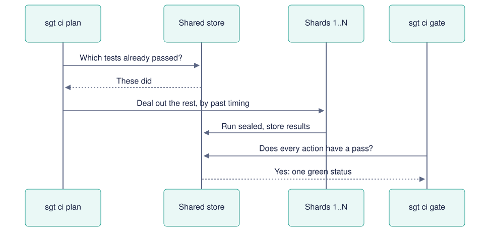

<p align="center">
  
</p>

<h3 align="center">The build system that knows every file.</h3>

<p align="center">
  Check, test and build a TypeScript, Luau or Rust workspace, and redo only what each edit can change.<br>
  A Luau program is built into one file of Lua 5.1. One binary. No config per package.
</p>

<p align="center">
  <a href="https://github.com/Braden1996/sergeant-releases/releases/latest"></a>
  
  
  
  
</p>

<p align="center">
  <a href="#does-sergeant-fit"><b>Does it fit?</b></a> ·
  <a href="#install">Install</a> ·
  <a href="#how-it-works">How it works</a> ·
  <a href="#setup-playbooks">Setup playbooks</a> ·
  <a href="#configuration">Configuration</a> ·
  <a href="#agent-workflow">Agent workflow</a> ·
  <a href="#benchmarks">Benchmarks</a>
</p>

```console
$ sgt check
ok: fmt, lint, decl, types and boundaries on 11 files

$ sgt test                      # after editing price.ts
ok: test on 2 files, 1 run and 1 already passed
```

```sh
# Linux & macOS (arm64 or x86-64)
curl -fsSL https://github.com/Braden1996/sergeant-releases/releases/latest/download/install.sh | sh
```

```powershell
# Windows (x86-64, PowerShell)
irm https://github.com/Braden1996/sergeant-releases/releases/latest/download/install.ps1 | iex
```

---

## Why Sergeant

Package-oriented build tools (Turborepo, Nx, Moon) schedule tasks one package at a time:
editing a single file inside a package invalidates that package's check and test tasks, and
editing a shared library invalidates every downstream package task.

Sergeant understands your repository at the level of **files, exported declarations, and
intra-file symbols**:

- **Body edits skip downstream typechecks.** Changing code inside a function without changing
  its exported signature rechecks only that file and reuses every downstream typecheck.
- **Symbol-level test selection.** Changing one exported function reruns only the test files
  whose call graph reaches that symbol—even sibling tests in the same package reuse their
  prior pass across both Bun and Vitest.
- **One binary, built-in fast path.** Formatting (OXC / StyLua / `rustfmt`), linting (built-in
  OXC + optional oxlint/ESLint/Selene/Clippy), isolated-declaration checking, TypeScript
  checking (`tsrs` / `tsc` / `tsgo`), and graph-native architectural boundaries run from a single
  `sgt` binary without per-package config boilerplate.
- **Shared cross-worktree cache for agents.** Multiple AI agents working in parallel git
  worktrees share one content-addressed cache with single-flight deduplication and structured
  JSON / MCP output.

---

## Does Sergeant fit?

Use this decision matrix (especially if you are an AI agent evaluating whether to introduce
Sergeant into a repository) before setting it up:

| Dimension | Strong fit (first-class) | Works with Adoption Mode | Not a fit |
| --- | --- | --- | --- |
| **Languages** | **TypeScript / JavaScript**, **Luau** (including strict **Lua 5.1** / **LuaJIT** targets, `\u{XXXX}` byte lowering, Lune & LuaJIT `*.spec.luau` / `*.test.luau`), **Rust** (`Cargo.toml` crates), or polyglot combinations of all three | Mixed repos where Python/Go/shell steps are wired via `"check"`, `"commands"`, or `"tasks"` in `sergeant.jsonc` | Pure Python, Go, JVM, C++, or .NET repositories with no TS/JS, Luau, or Rust units |
| **Frameworks & runtimes** | Bun services, Node services, React/Vite/Rsbuild web apps, Next.js, Astro, Electron, Expo / React Native, WXT extensions, Cloudflare Workers, AWS CDK / SST, Pulumi, Tauri, Storybook, Vitest, Playwright, World of Warcraft Lua 5.1 addons (`wow.addon.jsonc`) | Custom bundlers or codegen pipelines declared via `"tasks"` (`"into": "..."`) or `${<unit>:build}` tokens | Bespoke TypeScript compiler plugins/AST transformers that mutate types outside standard `tsconfig` |
| **Package managers** | **pnpm** (`pnpm-lock.yaml`) and **Bun** (`bun.lock`) — per-package lockfile slicing + workspace version catalog (`sgt add`) | **npm** (`package-lock.json`) and **Yarn** (`yarn.lock`) — supported via whole-lockfile hashing | Unpinned / lockfile-free `node_modules` trees |
| **Repo state** | Greenfield monorepos or clean packages ready for strict boundaries, isolated declarations, and zero `@ts-ignore` | Existing brownfield monorepos (`sgt init` + `sgt doctor --fix` + `sgt allow` shrink-only baseline in `sergeant.allow.jsonc`) | Repos that require circular runtime imports permanently and refuse baseline configuration |

### Key trade-offs to know upfront

1. **Strict by default, zero-config linters, shrink-only baseline.** Out of the box, Sergeant bans
   barrel re-exports (`boundaries/barrel`), circular runtime imports (`boundaries/cycle`), inline
   check suppressions (`@ts-ignore`, `eslint-disable`), undeclared/unused `package.json`
   dependencies, and cross-unit `tsconfig` `paths`. Linters and formatters stay in their own native
   configs (`.oxlintrc.jsonc`, `eslint.config.*`, `.oxfmtrc.jsonc`, `stylua.toml`, `selene.toml`,
   `clippy.toml`). In brownfield repos, **do not fight every violation on day one**—run
   `sgt doctor --fix` to populate workspace dependencies and record existing debt in
   `sergeant.allow.jsonc` (see [Playbook B](#playbook-b-existing-repository-adoption-brownfield)).
2. **Hermetic test assumptions.** Cacheable Bun unit tests run against captured source,
   package, and fixture inputs (in isolated virtual realms or private views, and kernel-sealed
   on Linux). Tests that mutate live host files outside the workspace or hit external networks
   must either use integration/E2E lanes, set `"cache": { "untrackable": "degrade" }`, or match
   `"cache": { "uncached": [...] }` in `sergeant.jsonc`.
3. **Native `bun` binary for Bun test reuse (Bun-free Vitest).** Sergeant hashes the test runner
   executable itself. Pure Node + Vitest workspaces run completely **Bun-free**. For Bun test
   suites, if `bun` on `PATH` is a shell wrapper script rather than a native binary (or symlink to
   one), Sergeant runs tests live without caching passes; real binaries on `PATH` (via
   [mise](https://mise.jdx.dev), `volta`, Homebrew, or direct install) preserve full reuse.
4. **macOS & Windows local caching vs Linux kernel sealing.** Prebuilt binaries target Linux
   (`x86-64`, `arm64`), macOS (`arm64`, `x86-64`), and Windows (`x86-64`). On macOS and
   Windows, unsealed runs still get **full per-file local and cross-worktree cache reuse** on
   that machine (`SGT_CACHE_DIR`), and can *read* sealed passes from a shared remote cache
   (`SGT_REMOTE_CACHE`); only Linux kernel-sealed runs (`--sealed` / `sgt ci`) *upload* to a
   shared remote cache.

---

## Install

### Linux & macOS (`arm64` and `x86-64`)

```sh
curl -fsSL https://github.com/Braden1996/sergeant-releases/releases/latest/download/install.sh | sh
```

Fetches the release archive for the host OS and architecture (`x86_64-unknown-linux-musl`,
`aarch64-unknown-linux-musl`, `aarch64-apple-darwin`, or `x86_64-apple-darwin`), verifies it
against its published `.sha256` digest, and installs `sgt` atomically into `~/.local/bin` (no
token required).

### Windows (`x86-64`, static-CRT `sgt.exe`)

```powershell
irm https://github.com/Braden1996/sergeant-releases/releases/latest/download/install.ps1 | iex
```

Verifies the archive SHA-256, installs `sgt.exe` into `%LOCALAPPDATA%\sergeant\bin`, and
prints the user `PATH` command if that directory is not yet on `PATH`.

### Pinning a version in CI or containers

```sh
curl -fsSL https://github.com/Braden1996/sergeant-releases/releases/download/v0.9.0/install.sh | SGT_VERSION=v0.9.0 sh
```

| Environment variable | Default | Purpose |
| --- | --- | --- |
| `SGT_VERSION` | `latest` | Release tag to install, such as `v0.9.0` |
| `SGT_INSTALL` | `~/.local/bin` (Unix) / `%LOCALAPPDATA%\sergeant\bin` (Windows) | Destination directory for `sgt` / `sgt.exe` |
| `SGT_FROM` | GitHub Releases | Mirror URL or `file:///path` holding the release archives and `.sha256` files |

TypeScript/JS workspaces typically install [Bun](https://bun.sh), [pnpm](https://pnpm.io) (or
Bun install), and [Node](https://nodejs.org)—pinned cleanly via root `mise.toml`. Run
`sgt doctor` at any time to verify detected toolchains, checker versions, Linux sealing
support, and cache locations.

---

## How it works

<picture>
  <source media="(prefers-color-scheme: dark)" srcset="docs/assets/diagrams/how-it-works-dark.svg">
  
</picture>

### 1. Units, roles, and explicit glob topology

A workspace is defined explicitly by root `sergeant.jsonc` (`sgt init` scaffolds it from existing
workspace manifests or folders). Sergeant makes **no default layout assumption**: every unit path
must be declared under `workspace` using exact directories or globs (`*`, `?`, `[...]`, `{a,b}`,
partial wildcards like `pkg-*`, and recursive `**` globs at any depth). Every matched folder is a
**unit**:

- **Libraries** (`workspace.libraries`) export code for other units to import and may declare
  `"platform": "neutral" | "browser" | "node" | "bun" | "native"` in `<unit>/sergeant.jsonc`.
- **Runtimes** (`workspace.runtimes`) are deployable or runnable programs (`service`,
  `web`, `nextjs`, `astro`, `electron`, `native`, `wxt`, `cloudflare`, `aws`, `pulumi`,
  `tauri`, `storybook`, `lune`, `rust`, plus optional integrations such as `wow-addon`).
- **Auto-classified packages** (`"packages": ["packages/**", "apps/*"]` at root or under
  `"workspace"`) infer runtime vs library automatically from unit files and dependencies.
- **Explicit preset composition (`"extends"`)**: Units can share explicit preset files via
  `"extends": "../../presets/luau-pure.jsonc"` (or an ordered array of relative presets) with
  additive `tags`, `allowDeps`, `dependencies`, and `test.setup` inheritance—checked for cycles
  and workspace containment with zero implicit directory magic.
- **Smart `@scope/<unit>` namespaces & dual addressing**: New and `sgt doctor --fix` units
  default to `@<scope>/<unit>` (inferred from `scope`, sibling manifests, or root
  `package.json`), while CLI commands accept **both** `@scope/<unit>` and short `<unit>`.

Units hold recognized directories (`src/`, `types/`, `public/`, `scripts/`, `fixtures/`,
`proofs/`, plus Cargo's `tests/`, `benches/`, `examples/` for Rust crates and framework
directories like `.storybook/` or `app/`).

### 2. Content-addressed file & symbol graph

Before reusing any cached parse, Sergeant rehashes source bytes (skipping unchanged settled
inodes on Unix via its stat cache). Built-in OXC and Full-Moon extractors build a workspace-wide
import and symbol graph in memory:

- **Direct source resolution**: Workspace package imports (`@acme/domain` or `domain/price.ts`)
  resolve straight to TypeScript/Luau source—no pre-build `.d.ts` or `dist/` step is needed
  between units.
- **Graph-native architectural boundaries (`sgt boundaries`)**: Runs directly over Sergeant's
  in-memory file & runtime closure graph across **TypeScript, Luau, and Rust**—no ESLint plugin
  required. Infers `publishable`, `private`, `scope:@org`, `role:*`, `kind:*`, `platform:*`, and
  `exports` visibility straight from `package.json` and workspace layout, and enforces
  package-level `visibility` (`"public"`, `"subtree"`, `"internal"`, or explicit friend lists),
  vertical `domains` isolation, topological `layers`, `forbidTransitive` (including runtime
  `capability:fs|net|process|host|io|load-effect|dynamic-import` containment with shortest `why`
  chains), `forbidExternal` with replacement hints, `maxExternalDeps`, and unit-level cycles
  (`noUnitCycles`).

### 3. Managed TypeScript presets, `tsgo` / `tsc` / `tsrs`, and declaration-surface caching

Traditional TypeScript monorepos either suffer slow whole-repo `tsc` runs or maintain fragile
`composite: true` project-reference graphs. Instead:

- **Per-package presets with optional `tsconfig.base.json` inheritance**: Sergeant embeds
  `@sgt-build/tsconfig/*` presets (`base`, `neutral`, `bun`, `node`, `browser`, `nextjs`,
  `wxt`, `cloudflare`, `react-native`, `bun-test`, `vitest`, `vitest-dom`). `sgt sync` writes
  clean unit `tsconfig.json` files for IDE support—splitting a package into separate
  `tsconfig.src.json` / `tsconfig.test.json` / `tsconfig.storybook.json` / `tsconfig.node.json`
  configs only when that package mixes runtime globals, with **no** cross-package `references`
  or `.tsbuildinfo` tax. If a workspace commits a root `tsconfig.base.json` with shared
  strictness flags, `sgt sync` extends both the runtime medium preset and `tsconfig.base.json`
  and strips duplicated options from every unit config automatically.
- **Your choice of checker (`tsrs`, `tsgo`, or `tsc`)**: `"typescript": { "checker": ... }`
  defaults to the built-in in-memory `tsrs` checker, or can be set to `"tsgo"` (using your
  workspace's pinned `@typescript/native-preview` binary or `tsgo` on `PATH`) or `"tsc"` for
  **1:1 diagnostic parity** with your existing CI compiler. Sergeant hashes the exact `tsgo` /
  `tsc` binary into every cache key.
- **Checker-agnostic declaration-surface skipping**: Before invoking `tsrs`, `tsgo`, or `tsc`,
  each file is looked up under **two keys**:
  1. Its full module-closure key (instant O(1) hit when nothing upstream changed).
  2. Its **declaration-surface key** (extracted by OXC `decl` independently of the checker):
     when an upstream implementation file changes inside a function body without altering its
     exported signature, downstream files reuse their cached `tsrs`, `tsgo`, or `tsc` results
     without spawning or running the checker on them.

### 4. Per-file test caching across Bun, Vitest, and Playwright

Every test lane caches passes **per individual test file**—batching is used only to amortize
runner startup across the **uncached** subset of tests:

| Test pattern / config | Lane & runner | Per-file key & execution model |
| --- | --- | --- |
| `*.test.ts(x)`, `*.spec.ts(x)` | `unit` (Bun) | **Cached per test file** by **intra-file symbol reach** + lockfile slice + fixtures + Bun digest. Pure suites run concurrently in isolated in-process Bun virtual realms; FS-reading tests run in private views. |
| `*.node.test.ts(x)` or unit `vitest.config.*` | `node` (Vitest) | **Cached per test file** by **intra-file symbol reach** for closed tests (falling back to file-level runtime import closure for opaque/external tests) + **surgical per-test lockfile package hashing** + `vitest.config.*` & `setupFiles` closures. Runs **Bun-free** on Node + Vitest workspaces. Cached files are skipped upfront; **only cache-missing files** are batched into `test.include` (up to `most = 64` per worker), preserving your `vitest.config.*` via Vite's `mergeConfig` (`environment`, `setupFiles`, `pool`, `poolOptions`, and Vite plugins). |
| `*.browser.test.ts(x)` | `browser` (Vitest + Playwright) | **Cached per test file** with **surgical per-test package hashing** and Bun-free execution; uncached component tests in a unit share one headless Chromium session per shard. |
| `*.int.test.ts(x)` | `integration` (Bun + services) | **Cached per test file**; starts needed workspace services (`"needs"` in `sergeant.jsonc`) on isolated ports per test and hashes service closures into the key. |
| `*.e2e.ts`, `*.e2e.test.ts` | `e2e` (Playwright) | **Cached per test file**; builds target web runtime + starts needed services. With `sgt test --record`, records visited routes so edits to unrelated routes skip the E2E test. |
| `*.test.luau`, `*.spec.luau` | `luau` (Lune or LuaJIT) | **Cached per test file** by runtime `require` closure + optional unit `"test": { "setup": "@pkg" }` closure + sibling `fixtures/`. Supports named function maps and deterministic ordered `{ { name, run } }` spec arrays on Lune or lowered Lua 5.1 / LuaJIT. |
| Rust `#[test]` & `tests/*.rs` | `rust` (Cargo) | Scoped per crate via Sergeant's `rustc` wrapper, keyed by crate closure and profile (with optional `"rust": { "cache": "local" }` tiered caching). |

On Linux, `--sealed` (or `SGT_SEALED=1`, enabled automatically in `sgt ci`) runs tests,
builds, and actions inside unprivileged user/mount/network namespaces and Landlock rules so a
process physically cannot read undeclared files or touch external networks.

### 5. Ephemeral `.sergeant/`, daemon, and shared worktree cache

- **Clean two-tier JSONC config, ephemeral `.sergeant/`**: Committed configuration lives at root
  `sergeant.jsonc`, optional `<unit>/sergeant.jsonc`, optional `mise.toml`, optional
  `sergeant.allow.jsonc`, and optional `sergeant.times.json`—backed by generated IDE JSON Schemas
  in `.sergeant/schema*.json`. Everything under `.sergeant/` is generated or transient per-worktree
  state (`.sergeant/out/`, graph state, daemon socket) and belongs in `.gitignore`.
- **Per-worktree daemon**: Starts automatically on demand, watches files, keeps the graph warm
  in memory, and produces **identical** exit codes and outputs to `--no-daemon`.
- **Cross-worktree & remote cache**: Stored in the OS cache directory (`SGT_CACHE_DIR`, auto-trimmed
  LRU to `SGT_CACHE_MAX` or 10 GB). Multiple git worktrees (`sgt worktree add <branch>`) reuse
  each other's passes immediately and coordinate in-flight keys so simultaneous identical runs
  execute once.

```console
$ sgt log
sgt test: exit 0 in 21 ms
changed since the command before: libraries/domain/src/price.ts
test: 1 ran in 11 ms, 1 reused
  libraries/domain/src/cart.test.ts  11 ms  reaches libraries/domain/src/price.ts
```

---

## Setup playbooks

### Playbook A: New workspace setup (greenfield)

Follow these exact steps for a clean, zero-drift workspace where every check, test, and build
works out of the box:

```sh
mkdir shop && cd shop
git init

# 1. Scaffold root sergeant.jsonc, JSON Schemas, mise.toml, and .gitignore (.sergeant/ ignored)
sgt init

# 2. Scaffold units (@shop/domain, @shop/api, @shop/page) that pass `sgt check` immediately
sgt new library domain                  # libraries/domain (shared pure TS library)
sgt new service api                     # runtimes/api     (Bun HTTP/service runtime)
sgt new web page                        # runtimes/page    (React web app)

# 3. Add packages through the workspace catalog (or link sibling units via `sgt add domain --to api`)
sgt add @types/bun --dev --to api
sgt add @types/bun --dev --to domain

# 4. Install dependencies and materialize IDE tsconfig / service-need bindings
sgt install
sgt sync

# 5. Verify the full gate, doctor, tests, build, and pre-commit hook
sgt check && sgt doctor && sgt test && sgt build
sgt hooks install
```

**Linking a web app or integration test to a backend service:** In `runtimes/page/sergeant.jsonc`,
write `{ "needs": ["api"] }`, then run `sgt sync`. Sergeant generates
`runtimes/page/src/needs.ts` with typed URLs; `sgt dev page` and `*.int.test.ts` / `*.e2e.ts`
start `api` automatically on a deterministic worktree-isolated port.

---

### Playbook B: Existing repository adoption (brownfield)

When adopting Sergeant in an existing monorepo (e.g. migrating from Turborepo, Nx, pnpm
workspaces, or Cargo), **follow this sequence** to reach a green `sgt check && sgt test`:

#### 1. Initialize root configuration

```sh
sgt init
```

`sgt init` inspects `pnpm-workspace.yaml`, root `package.json` `"workspaces"`, `Cargo.toml`,
and standard folders (`packages/*`, `apps/*`, `libraries/*`, `runtimes/*`), infers your
monorepo `@scope`, writes minimal `sergeant.jsonc`, `.sergeant/schema*.json`, and `mise.toml`
(if absent), and ensures `.sergeant/` is in `.gitignore`. Upgrading from an earlier `sergeant.toml`
workspace? Run `sgt migrate` to convert directly to `sergeant.jsonc`.

#### 2. Auto-populate dependencies and sync derived files

```sh
# Populate missing "workspace:*" & "catalog:" deps, promote public .d.ts surface types,
# prune redundant @types/*, and rewrite non-canonical cross-unit imports:
sgt doctor --fix

sgt sync
sgt units
```

#### 3. Auto-fix formatting/lints and baseline remaining debt

```sh
# Format and apply safe lint fixes across the workspace
sgt fix

# Record any remaining pre-existing diagnostics into `sergeant.allow.jsonc`
# `sgt check` will now pass with these entries, forbid any NEW violations,
# and automatically shrink `sergeant.allow.jsonc` as files are cleaned up.
sgt allow --reason "initial adoption baseline"
```

#### 4. Verify the full gate and existing package scripts

```sh
sgt check
sgt test
sgt tasks                               # lists taskDefaults, tasks, and package.json scripts
sgt run <unit>:<script>                 # run any unit task or package.json script through sgt
```

---

## Configuration

Sergeant keeps configuration focused strictly on **workspace topology, task/DAG orchestration,
caching, and architectural boundaries** in two-tier **`sergeant.jsonc`** (root + optional
`<unit>/sergeant.jsonc`), with full IDE autocomplete from `.sergeant/schema*.json`. Linters and
formatters live exclusively in their native tool configs.

### Root `sergeant.jsonc` reference

```jsonc
{
  "$schema": "./.sergeant/schema.json",

  // 1. Workspace topology & smart monorepo scope (required: no implicit default)
  "packages": ["packages/**", "apps/*", "crates/*"],
  "scope": "@acme",

  // 2. Ecosystem target & cache modes (optional)
  "rust": { "cache": "local" },
  "luau": { "target": "lua51", "runtime": "luajit", "forbidLuauStdlib": true },

  // 3. Pure cached check gates (run automatically during `sgt check`)
  "check": {
    "typos": {
      "run": ["typos"],
      "inputs": ["**/*", "!data/**", "!vendor/**"]
    },
    "verify-packs": {
      "run": ["${forge:build}/forge${exe}", "verify", "--strict"],
      "inputs": ["data/**"]
    }
  },

  // 4. Live commands (run via `sgt run <name>`, auto-building `${<unit>:build}` dependencies)
  "commands": {
    "deploy": {
      "dependsOn": ["check", "test"],
      "run": ["${forge:build}/forge${exe}", "deploy", "--addon", "${wow-addon:build}/MyAddon"]
    }
  },

  // 5. Inherited defaults & hermetic codegen (`into`)
  "taskDefaults": {
    "build": {
      "dependsOn": ["^build"],
      "inputs": ["src/**", "package.json"],
      "outputs": ["dist/**"],
      "cache": true
    }
  },
  "tasks": {
    "proto": {
      "description": "Generate protobuf TypeScript bindings",
      "run": ["protoc-gen", "--out", "$SGT_OUT"],
      "inputs": ["proto/**/*.proto"],
      "outputs": ["client.ts"],
      "into": "packages/proto/src/generated",
      "tools": ["protoc-gen"],
      "cache": true
    }
  },

  // 6. Graph-native architectural boundaries (TS, Luau & Rust; infers package.json traits automatically)
  "boundaries": {
    "defaultVisibility": "public",      // "public" | "subtree" | "internal"
    "noUnitCycles": true,               // ban unit-level runtime cycles even when files are acyclic
    "classify": [
      { "match": "packages/{domain}/{layer}", "tags": ["domain:{domain}", "layer:{layer}"] }
    ],
    "domains": { "isolate": true, "shared": ["shared", "ui"], "allowTypeOnly": true },
    "layers": [["core", "util"], ["domain"], ["feature", "ui"]],
    "rules": [
      {
        "from": "layer:core",
        "forbidTransitive": ["capability:fs", "capability:net", "capability:process"],
        "forbidExternal": { "lodash": "use native ES methods or radash" }
      }
    ]
  },

  // 7. Pinned external tool paths/locks for tasks
  "tools": {
    "protoc-gen": { "lock": "mise.lock" }
  }
}
```

### Per-unit `<unit>/sergeant.jsonc` reference

Units rarely need config; package traits (`publishable`, `private`, `scope:@org`, `exports`,
runtime `dependencies`) are inferred automatically from `package.json` and `Cargo.toml`. When a
package needs preset composition (`extends`), layer allowlists (`allowDeps`), service needs, or
test setup modules, place `sergeant.jsonc` at the unit root:

```jsonc
{
  "$schema": "../../.sergeant/schema.unit.json",
  "extends": "../../presets/ui-layer.jsonc",
  "platform": "browser",                // "neutral" | "browser" | "node" | "bun" | "native"
  "private": false,                     // `true` enforces internal visibility
  "visibility": "subtree",              // "public" | "subtree" | "internal" | ["unit-a", "domain:billing"]
  "tags": ["ui"],
  "allowDeps": ["core", "ui"],          // restrict production imports (`*.spec.*` / `*.test.*` may still import test doubles)
  "dependencies": ["core"],             // synced automatically for Luau units by `sgt doctor --fix`
  "test": {
    "setup": "@test-doubles/dom"        // loaded before unit specs & hashed into per-file test keys
  },
  "needs": ["api", "auth"],             // generates typed `src/needs.ts` on `sgt doctor --fix`
  "typescript": {
    "jsxImportSource": "@emotion/react"
  }
}
```

### Native formatter & linter configs (Zero Sergeant Config)

- **Formatting (`.oxfmtrc.jsonc`, `stylua.toml`, `rustfmt.toml`)**: Customize quotes, semicolons,
  line width, or `"ignorePatterns"` in `.oxfmtrc.jsonc`; Sergeant hashes it into every `fmt` key.
- **Fast custom linting (`.oxlintrc.jsonc`, `eslint.config.*`, `selene.toml`, `clippy.toml`)**:
  - Pure `.oxlintrc.jsonc` runs **in-process** in Rust (and composes with `@sgt-build/oxlint-config*`).
  - `.oxlintrc.jsonc` with `"jsPlugins"` or `oxlint.config.*` auto-invokes native `@oxlint/<os>-<arch>` in parallel shards.
  - `eslint.config.*` auto-runs in parallel shards with **3-tier cache invalidation** (`single-file`, `export-symbols`, and `export-surface` backed by `Check::Decl` with JSDoc preservation).

---

## Agent workflow

Sergeant is designed as the primary feedback loop for autonomous coding agents.

### 1. Connect via MCP (`sgt mcp`)

Expose all 20 Sergeant commands—checks, targeted tests, builds, task/action runs (`run`),
dependency edits (`add`, `remove`), config sync/migration (`sync`, `migrate`), and import-graph
queries (`deps`, `rdeps`, `why`)—directly as structured MCP tools over stdio:

```json
{
  "mcpServers": {
    "sergeant": {
      "command": "sgt",
      "args": ["mcp"]
    }
  }
}
```

Every MCP tool call returns both concise human-readable text and a parsed `structuredContent`
object (`{ exitCode, records, summary, stderr }`) and emits `notifications/progress` when the
client supplies a `progressToken`.

### 2. Agent CLI & exit-code contract

Agents interact with CLI tools more explicitly than humans—favoring deterministic JSON streams,
machine-readable exit codes, and targeted queries over scrolling raw terminal logs:

- **Exit codes distinguish code failures from tool errors**: `0` = green, `1` = problems found in
  code, `2` = usage or configuration error, `3` = internal error.
- **Bounded NDJSON (`--json` + `--limit`)**: Every check/query emits one JSON record per line
  followed by a final `{"summary": true, ...}` record counting every rule, so agents can diagnose
  a 1,000-file cascade from the top 50 records and summary counts without blowing up context.
- **Concrete slow & stall reporting**: Long-running active tasks emit live slow-heartbeat lines on
  stderr (`active, Xs`) without being killed, while genuinely wedged silent non-continuous tasks
  emit a stalled event and abort cleanly (continuous `mode: "watch"` tasks and `sgt dev` are never
  stall-aborted).
- **Recommended GitHub Actions setup**:

```yaml
- uses: Braden1996/sergeant/.github/actions/setup@v0.9.0
  with:
    version: v0.9.0
    luau-tools: true
    seal-sysctl: true
```

### 3. Streamlined CLI commands (`sgt --help`)

| Goal | Command | Notes |
| --- | --- | --- |
| Full commit / PR gate | `sgt check` | Runs `fmt --check`, `lint`, `decl`, `types`, `boundaries`, and declared `check` steps |
| Watch mode for checks / tests | `sgt check --watch` / `sgt test --watch` | Reruns incrementally on every save via the workspace watcher (supports `--json`) |
| Structured machine output | `sgt check --json` / `sgt test --json` | Emits one JSON diagnostic/event per line + final summary object |
| Check staged git index only | `sgt check --staged` | Verifies exact index tree without touching unstaged working tree edits |
| Auto-format & safe lint fixes | `sgt fix [targets...]` / `sgt fmt` | Rewrites formatting and deterministic lint fixes, then reports remaining issues |
| Run affected unit tests | `sgt test [targets...]` | Runs only tests lacking a cached pass for their current symbol/file closure |
| Build deployable runtimes | `sgt build [units...]` | Bundles TS/web/Rust/Luau/WoW runtimes into `.sergeant/out/<unit>/` |
| Run live commands or DAG tasks | `sgt run <cmd>` / `sgt run <unit>:<task>` | Executes live `commands`, runtimes, or parallel task DAGs with `^task` and `${<unit>:build}` |
| Start dev servers with `needs` | `sgt dev <runtime>` | Starts a runtime and needed sibling services on deterministic worktree-isolated ports |
| Inspect units, tasks & graph | `sgt graph units\|tasks\|deps\|rdeps\|why\|explain` | Queries units, tasks, callers (`rdeps --tests`), shortest `why` chains, and cache keys (`explain`) |
| Prune stale outputs only | `sgt clean [--stale]` | Deletes `.sergeant/out/` (or `--stale` orphaned entries while preserving live artifacts) |
| Diagnose & sync everything | `sgt doctor [--fix]` | Audits tools, TS/Luau/Rust manifests, schemas, `.luaurc`, `needs.ts` & recursive tasks (`--fix` repairs & syncs) |

### 4. Sharded sealed CI (`sgt ci`)

<picture>
  <source media="(prefers-color-scheme: dark)" srcset="docs/assets/diagrams/ci-dark.svg">
  
</picture>

Record historical test durations once with `sgt test --times` (committing `sergeant.times.json`),
point `SGT_REMOTE_CACHE` at an HTTP(S) cache or GitHub Actions cache (`github`), and split CI
across `N` parallel Linux runners:

```sh
sgt ci plan --shards 4 --out plan.json  # skips actions already passed in SGT_REMOTE_CACHE
sgt ci run --plan plan.json --shard 1   # runs shard 1 sealed on Linux and uploads passes
sgt ci gate --plan plan.json            # verifies all planned actions have a passing receipt
```

---

## Benchmarks

> **Note on engine versions across tables:** The 5-system Linux comparison below was recorded at
> Sergeant `0.3.0` (`176b920`, 2 vCPUs), prior to `0.6.0`'s in-process Bun virtual test realms
> and CSR/bitset graph engine. The native Windows table further below reflects Sergeant `0.9.0`
> (`c2420b6`).

### Linux (5-system comparison, 2 CPUs, Sergeant 0.3.0)

The tables below are one native run comparing Sergeant against direct uncached/incremental
tools and against Turborepo, Nx, Moon, and Bazel on the same generated sources, with
`tsrs 7.1.0-beta.tsrs1` for checks and `Bun 1.4.4` for tests. Two CPUs were available and each
scheduler could use two threads. Every row is the median of six rounds, measured 2026-11-21 on
two CPUs of an AMD EPYC 9V45 (Linux 7.0.0), at Sergeant 0.3.0 (`176b920`). Each ratio has a
95% bootstrap interval.

On the 1,005-file half (25 units, 200 tests), Sergeant had the lowest median of the build
systems on all six check workloads and on two of the five test workloads: a test after a
shared edit (293 ms, Turborepo 492 ms) and after a leaf edit (88 ms, Turborepo 106 ms).
Turborepo was lower on a cold test (462 ms, Sergeant 551 ms), an unchanged one (70 ms, 85 ms)
and a fresh checkout (75 ms, 102 ms).

#### 10,050 files in 250 units (2,000 tests, Linux, 2 CPUs)

On the 10,050-file half, Sergeant had the lowest build-system median on all 11 workloads.
With no edits, Sergeant reused all 40,201 check results in 126 ms, versus 6.54 s for the
direct pipeline with incremental TSRS. Sergeant reused results for all 2,000 test files in
136 ms, while direct Bun ran those files in 1.26 s. Times are medians.

| Situation | Sergeant | Work redone | Direct tool and time | Direct / Sergeant |
| --- | ---: | ---: | --- | ---: |
| `check`, cold | 1.01 s | 40,201 of 40,201 | OXC, declarations, TSRS 929 ms | 0.91× [0.86, 1.32], inconclusive |
| `check`, nothing changed | 126 ms | 0 of 40,201 | OXC, declarations, incremental TSRS 6.54 s | 51.24× [44.74, 60.49] |
| `check` after editing a shared file | 620 ms | 7,155 of 40,201 | OXC, declarations, incremental TSRS 6.95 s | 11.25× [10.51, 12.59] |
| `check` after editing inside a function of a shared file | 184 ms | 4 of 40,201 | OXC, declarations, incremental TSRS 6.53 s | 36.14× [30.44, 38.78] |
| `check` after editing a leaf file | 179 ms | 4 of 40,201 | OXC, declarations, incremental TSRS 6.47 s | 36.33× [33.98, 37.79] |
| the same, daemon running | 186 ms | 4 of 40,201 | OXC, declarations, incremental TSRS 6.50 s | 35.01× [33.94, 36.22] |
| `check` in a fresh checkout, cache shared | 205 ms | 0 of 40,201 | — | — |
| `test`, cold | 3.43 s | 2,000 of 2,000 | `bun test --isolate` (all 2,000) 1.25 s | 0.37× [0.35, 0.39] |
| `test`, nothing changed | 136 ms | 0 of 2,000 | `bun test --isolate` (all 2,000) 1.26 s | 9.38× [5.86, 9.78] |
| `test` in a fresh checkout, cache shared | 261 ms | 0 of 2,000 | — | — |
| `test` after editing a shared file | 1.94 s | 685 of 2,000 | `bun test --isolate` (all 2,000) 1.64 s | 0.73× [0.71, 0.94] |
| `test` after editing a leaf file | 146 ms | 0 of 2,000 | `bun test --isolate` (all 2,000) 1.45 s | 9.85× [8.61, 10.36] |

| Situation | Sergeant | Turborepo | Nx | Moon | Bazel |
| --- | ---: | ---: | ---: | ---: | ---: |
| `check`, cold | 1.01 s | 21.20 s<br><sub>20.80× [20.06, 21.44]</sub> | 50.45 s<br><sub>50.12× [46.76, 50.65]</sub> | 27.81 s<br><sub>27.65× [26.26, 27.96]</sub> | 33.66 s<br><sub>33.05× [32.43, 33.69]</sub> |
| `check`, nothing changed | 126 ms | 242 ms<br><sub>1.89× [1.64, 2.49]</sub> | 771 ms<br><sub>6.19× [5.25, 6.77]</sub> | 7.58 s<br><sub>59.68× [53.11, 61.60]</sub> | 339 ms<br><sub>2.65× [2.08, 4.10]</sub> |
| `check` after editing a shared file | 620 ms | 22.57 s<br><sub>36.77× [35.69, 41.90]</sub> | 52.99 s<br><sub>84.53× [82.44, 98.53]</sub> | 29.15 s<br><sub>46.61× [45.42, 52.61]</sub> | 26.12 s<br><sub>41.99× [41.28, 50.35]</sub> |
| `check` after editing inside a function of a shared file | 184 ms | 21.02 s<br><sub>119.80× [100.99, 127.76]</sub> | 51.13 s<br><sub>282.11× [241.51, 305.90]</sub> | 28.52 s<br><sub>156.16× [132.15, 171.61]</sub> | 25.07 s<br><sub>141.38× [119.55, 160.66]</sub> |
| `check` after editing a leaf file | 179 ms | 378 ms<br><sub>2.14× [2.10, 2.28]</sub> | 1.06 s<br><sub>6.01× [5.54, 6.16]</sub> | 8.02 s<br><sub>44.87× [42.39, 47.07]</sub> | 504 ms<br><sub>2.86× [2.56, 4.05]</sub> |
| `check` in a fresh checkout, cache shared | 205 ms | 510 ms<br><sub>2.49× [2.34, 2.75]</sub> | — | — | 9.26 s<br><sub>44.58× [43.67, 52.10]</sub> |
| `test`, cold | 3.43 s | 5.02 s<br><sub>1.46× [1.36, 1.50]</sub> | 34.68 s<br><sub>10.14× [9.45, 10.87]</sub> | 18.06 s<br><sub>5.23× [4.85, 5.81]</sub> | 48.43 s<br><sub>14.04× [13.61, 15.19]</sub> |
| `test`, nothing changed | 136 ms | 240 ms<br><sub>1.79× [1.42, 1.93]</sub> | 825 ms<br><sub>5.84× [4.12, 6.10]</sub> | 8.17 s<br><sub>58.32× [39.00, 61.01]</sub> | 545 ms<br><sub>3.86× [2.85, 4.52]</sub> |
| `test` in a fresh checkout, cache shared | 261 ms | 571 ms<br><sub>2.23× [0.89, 2.84], inconclusive</sub> | — | — | 48.15 s<br><sub>183.28× [77.79, 202.42]</sub> |
| `test` after editing a shared file | 1.94 s | 5.61 s<br><sub>2.93× [2.38, 2.96]</sub> | 36.99 s<br><sub>19.04× [14.95, 20.52]</sub> | 18.99 s<br><sub>9.84× [7.61, 10.58]</sub> | 23.29 s<br><sub>11.62× [9.59, 12.61]</sub> |
| `test` after editing a leaf file | 146 ms | 305 ms<br><sub>2.11× [1.81, 2.19]</sub> | 1.14 s<br><sub>7.36× [6.89, 8.23]</sub> | 9.50 s<br><sub>65.06× [56.20, 69.08]</sub> | 706 ms<br><sub>4.88× [4.23, 6.59]</sub> |

<sub>10,050 files in 250 units. Median elapsed times across 6 rounds (6 cold). Measured 2026-11-21 on AMD EPYC 9V45 96-Core Processor (2 available CPUs, Linux 7.0.0-1017-azure, job limit 2), source snapshot `176b92024c00dafa7233d575af93b9f0983b6446`. Build systems measured include Turborepo 2.11.11, Nx 24.0.6, Moon 2.6.5 and Bazel 9.3.2. Ratios divide each comparison time by Sergeant’s time in the same round and take the median on a log scale. Above 1× means Sergeant took less time. Brackets show 95% bootstrap intervals.</sub>

### Windows (Sergeant 0.9.0, 32 threads)

The same harness ran natively on Windows, on an AMD Ryzen 9 9950X3D, 16 cores and 32 threads,
94 GB of memory, Windows 11 Pro 25H2, at Sergeant 0.9.0 (`c2420b6`), with
`tsrs 7.1.0-beta.tsrs1`, `Bun 1.4.4`, and the same six rounds (measured 2026-11-25). Every
scheduler could use 32 threads, so these times do not compare with the two-CPU Linux run above.

At 10,050 files Sergeant was faster than the direct tools on **nine of the ten compared rows**:
every warm and incremental check (`6.78×` to `43.46×`) and **every** test workload—including
a cold test run (`463 ms` vs `1.63 s` for `bun test --isolate`, `3.52×`), tests after editing
a shared file (`463 ms` vs `1.65 s`, `3.54×`), unchanged tests (`154 ms` vs `1.64 s`,
`10.74×`), and leaf-edit tests (`154 ms` vs `1.62 s`, `10.77×`). Only a cold check was faster
in the direct tools (`548 ms`, Sergeant `882 ms`). At 1,005 files Sergeant had **zero losses**,
winning every warm and incremental row (`1.29×` to `3.45×`) and tying within parity on all
three cold and shared-edit test rows.

With no edits, Sergeant reused all 40,201 check results in 347 ms, versus 5.51 s for the
direct pipeline with incremental TSRS. Sergeant reused results for all 2,000 test files in
154 ms, while direct Bun ran those files in 1.64 s. Times are medians.

| Situation | Sergeant | Work redone | Direct tool and time | Direct / Sergeant |
| --- | ---: | ---: | --- | ---: |
| `check`, cold | 882 ms | 40,201 of 40,201 | OXC, declarations, TSRS 548 ms | 0.59× [0.58, 0.67] |
| `check`, nothing changed | 347 ms | 0 of 40,201 | OXC, declarations, incremental TSRS 5.51 s | 15.68× [14.40, 16.78] |
| `check` after editing a shared file | 884 ms | 7,155 of 40,201 | OXC, declarations, incremental TSRS 5.88 s | 6.78× [6.47, 7.13] |
| `check` after editing inside a function of a shared file | 425 ms | 4 of 40,201 | OXC, declarations, incremental TSRS 5.53 s | 13.03× [12.16, 14.05] |
| `check` after editing a leaf file | 394 ms | 4 of 40,201 | OXC, declarations, incremental TSRS 5.58 s | 14.03× [13.32, 14.77] |
| the same, daemon running | 126 ms | 4 of 40,201 | OXC, declarations, incremental TSRS 5.48 s | 43.46× [36.64, 44.69] |
| `check` in a fresh checkout, cache shared | 373 ms | 0 of 40,201 | — | — |
| `test`, cold | 463 ms | 2,000 of 2,000 | `bun test --isolate` (all 2,000) 1.63 s | 3.52× [3.41, 3.78] |
| `test`, nothing changed | 154 ms | 0 of 2,000 | `bun test --isolate` (all 2,000) 1.64 s | 10.74× [9.47, 10.96] |
| `test` in a fresh checkout, cache shared | 161 ms | 0 of 2,000 | — | — |
| `test` after editing a shared file | 463 ms | 685 of 2,000 | `bun test --isolate` (all 2,000) 1.65 s | 3.54× [3.44, 3.70] |
| `test` after editing a leaf file | 154 ms | 0 of 2,000 | `bun test --isolate` (all 2,000) 1.62 s | 10.77× [9.58, 11.03] |

<details>
<summary><b>1,005 files in 25 units, 200 tests (Windows 11 Pro, Sergeant 0.9.0)</b></summary>

<br>

| Situation | Sergeant | Work done | Direct tool | Direct time | Direct / Sergeant |
| --- | ---: | ---: | --- | ---: | ---: |
| `check`, cold | 140 ms | 4,021 of 4,021 | OXC, declarations, TSRS | 139 ms | 1.00× [0.93, 1.15], inconclusive |
| `check`, nothing changed | 67 ms | 0 of 4,021 | OXC, declarations, incremental TSRS | 148 ms | 2.27× [2.12, 2.41] |
| `check` after editing a shared file | 132 ms | 690 of 4,021 | OXC, declarations, incremental TSRS | 170 ms | 1.29× [1.24, 1.33] |
| `check` after editing inside a function of a shared file | 82 ms | 4 of 4,021 | OXC, declarations, incremental TSRS | 157 ms | 1.95× [1.76, 2.21] |
| `check` after editing a leaf file | 95 ms | 4 of 4,021 | OXC, declarations, incremental TSRS | 157 ms | 1.67× [1.58, 2.02] |
| the same, daemon running | 46 ms | 4 of 4,021 | OXC, declarations, incremental TSRS | 150 ms | 3.19× [2.34, 3.59] |
| `check` in a fresh checkout, cache shared | 73 ms | 0 of 4,021 | — | — | — |
| `test`, cold | 188 ms | 200 of 200 | `bun test --isolate` (all 200) | 179 ms | 0.96× [0.91, 1.01], inconclusive |
| `test`, nothing changed | 51 ms | 0 of 200 | `bun test --isolate` (all 200) | 167 ms | 3.33× [3.11, 3.48] |
| `test` in a fresh checkout, cache shared | 54 ms | 0 of 200 | — | — | — |
| `test` after editing a shared file | 181 ms | 58 of 200 | `bun test --isolate` (all 200) | 178 ms | 0.99× [0.83, 1.00], inconclusive |
| `test` after editing a leaf file | 50 ms | 0 of 200 | `bun test --isolate` (all 200) | 170 ms | 3.45× [3.31, 3.66] |

</details>

<sub>10,050 files in 250 units (and 1,005 files in 25 units). Median elapsed times across 6 rounds (6 cold). Measured 2026-11-25 on an AMD Ryzen 9 9950X3D, 16 cores and 32 threads, 94 GB of memory, Windows 11 Pro 25H2 (32 available CPUs, job limit 32), Sergeant 0.9.0, source snapshot `c2420b6398e4e0ae00970e909db7558e34926630`. Check arms use tsrs 7.1.0-beta.tsrs1 and test arms use Bun 1.4.4 with isolation. Ratios divide the direct time by Sergeant’s time in the same round and take the median on a log scale. Above 1× means Sergeant took less time. Brackets show 95% bootstrap intervals.</sub>

---

This repository distributes Sergeant's public binary releases and installers (`install.sh` and
`install.ps1`). Sergeant builds on [oxc](https://oxc.rs), the TypeScript checker,
[StyLua](https://github.com/JohnnyMorganz/StyLua), [selene](https://github.com/Kampfkarren/selene),
[Lune](https://github.com/lune-org/lune), [Bun](https://bun.sh), [Vitest](https://vitest.dev),
[Playwright](https://playwright.dev), [Rsbuild](https://rsbuild.dev) and [pnpm](https://pnpm.io),
and on ideas from [Bazel](https://bazel.build) and [Buck2](https://buck2.build).
