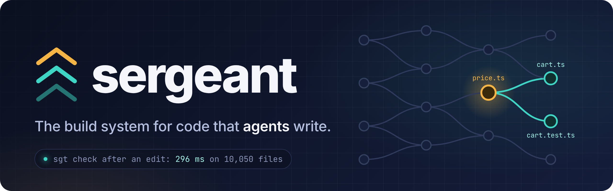
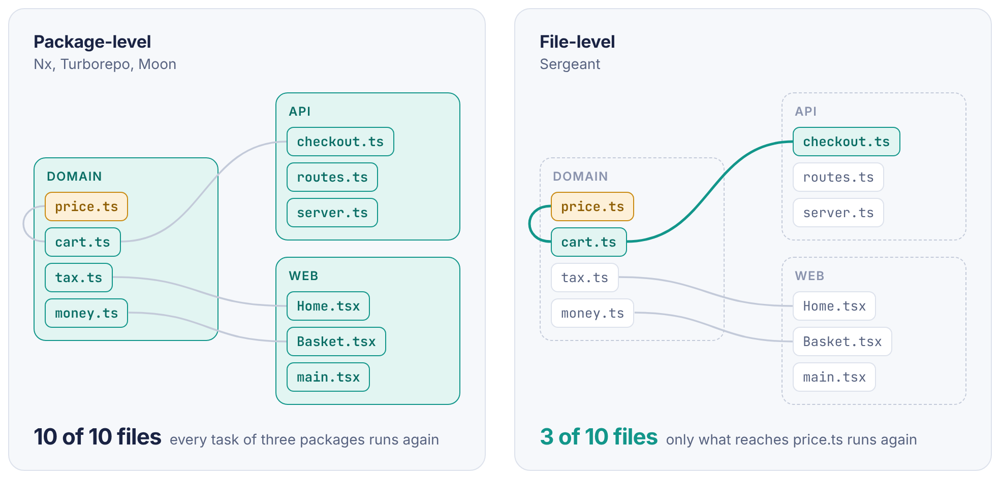
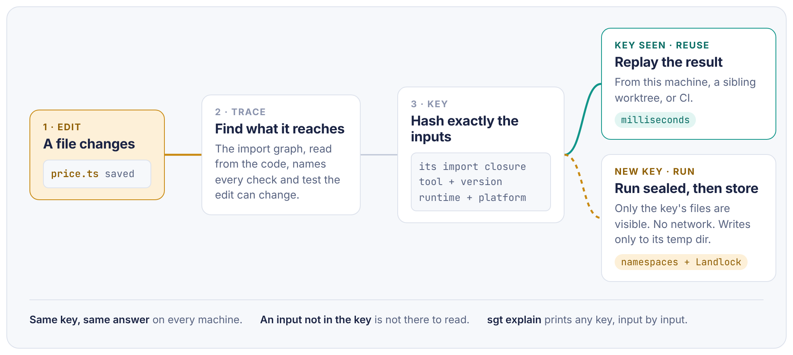
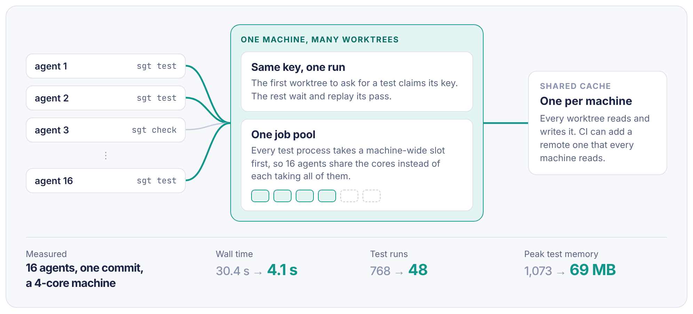
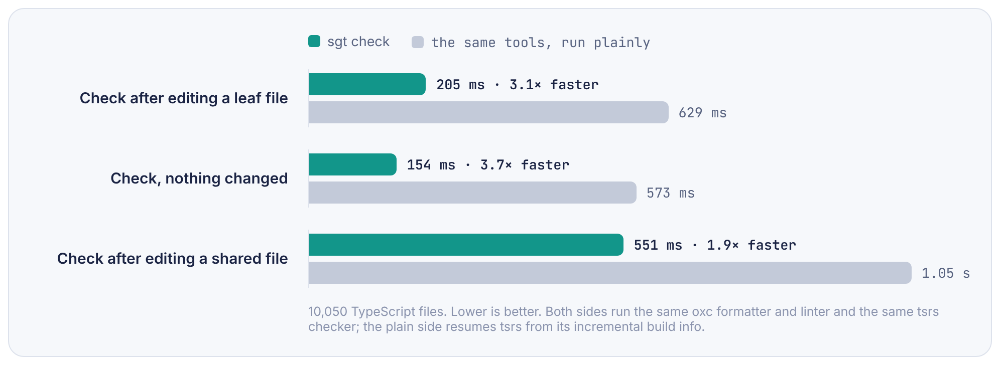

<p align="center">
  
</p>

<p align="center">
  <b>Check, test and build a monorepo, and redo only what each edit can change.</b><br>
  One Rust binary for TypeScript, Luau and Rust. Sealed runs, honest cache keys, no config per package.
</p>

<p align="center">
  <a href="https://github.com/Braden1996/sergeant-releases/releases/latest"></a>
  
  
  
</p>

<p align="center">
  <a href="#install"><b>Install</b></a> ·
  <a href="#commands">Commands</a> ·
  <a href="#benchmarks">Benchmarks</a> ·
  <a href="#how-it-compares">How it compares</a>
</p>

```sh
curl -fsSL https://raw.githubusercontent.com/Braden1996/sergeant-releases/main/install.sh | sh
```

## The problem

Build tools were designed around a person: one checkout, a few edits an hour, and someone
who knows the cache is sometimes wrong. Coding agents break all three. They edit dozens of
times a minute, a dozen of them work on one machine at once, and they believe whatever the
tools print.

That turns old trade-offs into real costs. A cache keyed on a whole package reruns the
package, and everything that depends on it, after every edit. A cache whose inputs someone
listed by hand will one day replay a stale pass, and an agent will ship on it. A
`// @ts-ignore` is one keystroke from a green check. And sixteen agents that each start a
full test run fight over the same cores to work out the same answers sixteen times.

## What Sergeant does

Sergeant starts from the files. It reads every import, so it knows the exact inputs of each
check and each test. An edit reruns only what it reaches, and a cached pass is the answer
that code would get if you ran it again.

<picture>
  <source media="(prefers-color-scheme: dark)" srcset="assets/granularity-dark.png">
  
</picture>

- **File-level, not package-level.** Format and lint work on one file. A file's type
  errors are cached under the closure of what it imports. A test reruns when something it
  imports changes, and not otherwise.
- **Keys that can't lie.** Every result is stored under a hash of exactly what it was made
  from. On Linux each test and build runs sealed, in a root that holds only the files in its
  key, with no network, so an input missing from the key isn't there to be read.
- **No escape hatches.** `@ts-ignore`, `eslint-disable` and `--!nocheck` are errors. A
  codebase that arrives with problems records them in a baseline that can only shrink.
- **No config per package.** The formatter, linter and type checker are built in. A
  package's kind comes from its layout, so there is no tsconfig, ESLint or bundler config
  to drift.
- **Every answer explains itself.** `sgt log` says what ran and what was reused,
  `sgt explain` prints any result's key input by input, and every command speaks `--json`.

## How it works

<picture>
  <source media="(prefers-color-scheme: dark)" srcset="assets/how-it-works-dark.png">
  
</picture>

A daemon per worktree keeps the graph in memory, so the trace costs milliseconds. Keys are
content only, so the same key gives the same answer in your worktree, in a sibling
worktree, and in CI. A shared remote cache can be added, and only sealed CI runs write to it.

## Built for many agents on one machine

Each agent gets its own worktree, and they share one cache. When two worktrees ask for the
same test at once, the first runs it and the second replays its pass. Every test process
takes a slot from one machine-wide pool, so sixteen agents share the cores instead of each
taking all of them.

<picture>
  <source media="(prefers-color-scheme: dark)" srcset="assets/agents-dark.png">
  
</picture>

### Why sharing a cache across worktrees is safe

A key is not a test's name. It is a hash of every byte the test can read: the file,
everything it imports, the lockfile, the toolchain and the settings. Two worktrees with
different edits anywhere in a test's imports get different keys and each run their own. Two
with the same bytes get the same key, and the replayed pass is the answer they would have got
by running it. A failure is never kept, so a worktree that waited on one runs the test
itself. On Linux, sealing is what makes the key complete: the test can't open a file the key
missed, because it isn't there. Where runs aren't sealed, as on Windows today, the key is
still everything the imports say, but a test that reads a file it never imports isn't
stopped. Only sealed CI runs write to a shared remote cache.

## Commands

```sh
# Start a workspace
sgt new library domain              # shared code in libraries/
sgt new service api                 # a Bun service in runtimes/
sgt new web page                    # a React page, bundled by Rsbuild
sgt add zod --to api                # packages go through pnpm, pinned by the lockfile
sgt doctor                          # what this machine is missing, and whether it can seal

# The loop
sgt check                           # format, lint, declarations, types and import boundaries
sgt check --staged                  # exactly what the next commit holds
sgt fix                             # format, and apply the lint fixes that are safe
sgt test                            # the tests whose inputs changed
sgt test --fail-fast                # tests near your last edit first; stop at the first failure
sgt test --type all                 # unit, browser, integration and end-to-end
sgt build                           # bundle every service and page, as cached actions
sgt dev api                         # run a service and what it needs, restarting on edits

# Ask why
sgt log                             # what the last command ran, reused, and why
sgt explain test <file>             # that test's key, input by input
sgt rdeps --tests <file>            # which tests an edit to <file> would rerun
sgt why <from> <to>                 # the shortest import chain between two files

# Agents and worktrees
sgt worktree add fix-tax            # a checkout with its own ports, sharing the cache
sgt mcp                             # every verb as an MCP tool

# CI
sgt ci plan --shards 4              # skip what already passed, split the rest by timing
sgt ci run --shard 2/4 --plan <p>   # one shard, sealed
sgt ci gate --plan <p>              # the one required status
```

Point an agent at it with:

```json
{ "mcpServers": { "sergeant": { "command": "sgt", "args": ["mcp"] } } }
```

## Benchmarks

`sgt check` and `sgt test` against the very tools Sergeant runs, run plainly over a generated
workspace of 10,050 files: the oxc formatter and linter and the declaration check on every
file, tsrs on every program, and `bun test` on every test. Once tsrs has run it resumes from
its own incremental build info. The tools are the same on both sides, so the difference is
only what the build system chooses not to redo.

<picture>
  <source media="(prefers-color-scheme: dark)" srcset="assets/benchmarks-dark.png">
  
</picture>

The whole run, including where Sergeant is slower. A cold `check` does all the work the plain
tools do, then also checks the import rules and writes every result to its cache, and ends up
about level with them. `sgt test`
gives every test file a fresh global object so that one file can't leak into another, which
costs time beside one `bun test` process when every test has to run.

| | Sergeant | Same tools, plainly | | Work redone |
| --- | ---: | ---: | ---: | ---: |
| `check`, cold | 939 ms | 922 ms | about the same | 40,200 of 40,200 |
| `check`, nothing changed | 154 ms | 573 ms | 3.7× faster | 0 of 40,200 |
| `check` after editing a shared file | 551 ms | 1.05 s | 1.9× faster | 7,155 of 40,200 |
| `check` after editing inside a function of a shared file | 206 ms | 654 ms | 3.2× faster | 4 of 40,200 |
| `check` after editing a leaf file | 205 ms | 629 ms | 3.1× faster | 4 of 40,200 |
| the same, daemon running | 101 ms | 668 ms | 6.6× faster | 4 of 40,200 |
| `test`, cold | 1.49 s | 1.41 s | about the same | 2,000 of 2,000 |
| `test`, nothing changed | 133 ms | 1.33 s | 9.9× faster | 0 of 2,000 |
| `test` after editing a shared file | 978 ms | 1.36 s | 1.4× faster | 685 of 2,000 |
| `test` after editing a leaf file | 123 ms | 1.28 s | 10.4× faster | 0 of 2,000 |

Sixteen agents running `sgt test` at once on one commit, on a 4-core machine with 48
CPU-bound test files each: **30.4 s → 4.1 s** wall time and **768 → 48** test runs once
the job pool and one-run-per-key landed. With every key different, so nothing can be
shared, the pool still cuts peak test memory from 1,077 MB to 135 MB.

<sub>Medians on 4 cores of an Intel Xeon @ 2.30GHz (Linux), 2026-11-17, commit 78e4e10, tsrs 7.1.0-beta.tsrs1 and
Bun 1.4.4. The plain `bun test` reruns all 2,000 tests whatever changed. The workspaces are
generated and regular, so real repositories are slower for both; the ratios say more than
the times.</sub>

### Beside other build systems

The same workspace under Turborepo, Nx, Moon and Bazel, each configured as its documentation
recommends and running exactly the tools Sergeant runs, once per package: the same tsrs and
oxc, and `bun test --isolate`. Nobody runs `tsc`, so the build system is the only difference.

| | Sergeant | Turborepo | Nx | Moon | Bazel |
| --- | ---: | ---: | ---: | ---: | ---: |
| `check`, cold | **939 ms** | 18.84 s | 32.19 s | 26.52 s | 33.66 s |
| `check`, nothing changed | 154 ms | **140 ms** | 611 ms | 6.23 s | 395 ms |
| `check` after editing a shared file | **551 ms** | 19.45 s | 31.31 s | 26.42 s | 27.36 s |
| `check` after editing inside a function of a shared file | **206 ms** | 18.16 s | 31.82 s | 26.16 s | 27.91 s |
| `check` after editing a leaf file | **205 ms** | 326 ms | 1.09 s | 6.30 s | 788 ms |
| `check` in a fresh checkout, cache shared | 195 ms | **172 ms** | 34.50 s | 29.29 s | 5.52 s |
| `test`, cold | **1.49 s** | 2.06 s | 14.38 s | 11.08 s | 49.78 s |
| `test`, nothing changed | **133 ms** | 189 ms | 621 ms | 7.03 s | 560 ms |
| `test` in a fresh checkout, cache shared | **175 ms** | 238 ms | 14.63 s | 10.20 s | 50.41 s |
| `test` after editing a shared file | **978 ms** | 2.05 s | 15.48 s | 10.39 s | 8.61 s |
| `test` after editing a leaf file | **123 ms** | 172 ms | 988 ms | 6.40 s | 564 ms |

Where nothing has to run, Turborepo and Sergeant are within about 25 ms of each other, and
Turborepo is slightly ahead on two `check` rows. The gap is in cold runs and after an edit,
where a package-level system reruns every package the edit touches and starts a checker for
each one. An edit inside a function body changes no file's declarations, so Sergeant rechecks
only that file; the others rerun every package that imports it.

<sub>10,050 files in 250 units, medians of 5 runs (3 cold), tools taking turns each round, on
4 cores of an Intel Xeon @ 2.30GHz (Linux), 2026-11-17, commit 78e4e10. Turborepo 2.11.11, Nx 24.0.6, Moon
2.6.5 and Bazel 9.3.2. Nx and Moon have no shared cache without a remote cache server, so in a
fresh checkout they rerun everything.</sub>

## How it compares

|  | Unit of work | Where inputs come from | Isolation | Config you write |
| --- | --- | --- | --- | --- |
| **Bazel** | a target in a BUILD file | declared by hand in Starlark | sandbox per action, remote execution | BUILD files and rules |
| **Buck2** | a target in a BUCK file | declared by hand in Starlark | sandbox, remote execution | BUCK files and rules |
| **Pants** | a target, often per file | inferred from imports | a temporary directory per process, remote execution | BUILD files, mostly generated |
| **Nx** | a project's task | globs per task, plus the project graph | none: tasks run in place | `project.json` or `package.json`, plugins |
| **Turborepo** | a package's script | globs per task, plus package dependencies | none | `turbo.json` |
| **Moon** | a project's task | globs per task | none | `moon.yml` per project |
| **Sergeant** | one check or test on one file | read from your imports | sealed on Linux: namespaces, Landlock, no network | none per package |

Bazel and Buck2 are the right choice for a large polyglot codebase that needs remote
execution today, and Sergeant takes their central idea: a result is a function of its
inputs, and nothing else. It differs in where those inputs come from. Sergeant reads them
from the code instead of asking you to declare them, which only works because it is narrow
and opinionated: a fixed layout of `libraries/` and `runtimes/`, a fixed toolchain, and no
plugins.

Nx, Turborepo and Moon are quick to adopt because they wrap the scripts you already have.
The price is that their cache is only as honest as the globs you wrote, and their unit is
the package, so an agent's one-line edit reruns everything a package touches.

## What it supports

| | |
| --- | --- |
| **TypeScript** | Libraries, Bun services, React pages (Rsbuild), Electron apps, Astro sites, Expo apps. Tests with Bun, Vitest browser mode and Playwright. |
| **Luau** | Lune programs and tests, World of Warcraft addons. Typechecked by luau-lsp in strict mode, formatted by StyLua, linted by selene. |
| **Rust** | Partial. A crate is one unit and Cargo does the compiling; Sergeant decides when Cargo needs asking, and a new worktree reuses the dependencies another one compiled. |
| **Linux** | Prebuilt, static binaries for x86-64 and arm64. Sealed runs need Linux 6.7 with Landlock and unprivileged user namespaces. |
| **Windows** | A prebuilt `sgt.exe` for x86-64, installed with `install.ps1`. Runs are not sealed. |
| **macOS** | No published binary yet. |

## Install

```sh
curl -fsSL https://raw.githubusercontent.com/Braden1996/sergeant-releases/main/install.sh | sh
```

This fetches the archive for the machine it runs on, checks it against its published
sha256, and puts `sgt` in `~/.local/bin`. It needs no token. Sergeant also expects
[Bun](https://bun.sh), [pnpm](https://pnpm.io) and [Node](https://nodejs.org) on the path,
and `sgt doctor` says what is missing.

On Windows, in PowerShell:

```powershell
irm https://github.com/Braden1996/sergeant-releases/releases/latest/download/install.ps1 | iex
```

This puts `sgt.exe` in `%LOCALAPPDATA%\sergeant\bin`, after the same sha256 check, and
prints the line that adds that folder to your path. `SGT_VERSION` works the same way.

| Variable | What it does |
| --- | --- |
| `SGT_VERSION` | The release to install, as its tag: `v0.1.0`. Left out, the latest. |
| `SGT_INSTALL` | The directory `sgt` goes in. Left out, `~/.local/bin`. |
| `SGT_FROM` | An address that holds the archives in place of GitHub: a mirror or a bucket. |

In CI or a container, pin the version:

```sh
curl -fsSL https://raw.githubusercontent.com/Braden1996/sergeant-releases/main/install.sh | SGT_VERSION=v0.1.0 sh
```

---

This repository holds releases only; Sergeant's source is not public yet. It builds on
[oxc](https://oxc.rs), the TypeScript checker, [Bun](https://bun.sh),
[Rsbuild](https://rsbuild.dev), [pnpm](https://pnpm.io), [Lune](https://github.com/lune-org/lune),
[StyLua](https://github.com/JohnnyMorganz/StyLua) and [selene](https://github.com/Kampfkarren/selene),
and on ideas from [Bazel](https://bazel.build) and [Buck2](https://buck2.build). The images
here are rendered from HTML in [`assets/`](assets/README.md).
