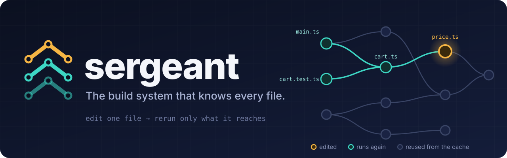

<p align="center">
  
</p>

<h3 align="center">The build system that knows every file.</h3>

<p align="center">
  Check, test and build a TypeScript, Luau or Rust workspace, and redo only what each edit can change.<br>
  A Luau program is built into one file of Lua 5.1. One binary. No config per package.
</p>

<p align="center">
  <a href="https://github.com/Braden1996/sergeant-releases/releases/latest"></a>
  
  
  
  
</p>

<p align="center">
  <a href="#does-sergeant-fit"><b>Does it fit?</b></a> ·
  <a href="#install">Install</a> ·
  <a href="#how-it-works">How it works</a> ·
  <a href="#setup-playbooks">Setup playbooks</a> ·
  <a href="#configuration">Configuration</a> ·
  <a href="#agent-workflow">Agent workflow</a> ·
  <a href="#benchmarks">Benchmarks</a>
</p>

```console
$ sgt check
ok: fmt, lint, decl, types and boundaries on 11 files

$ sgt test                      # after editing price.ts
ok: test on 2 files, 1 run and 1 already passed
```

```sh
# Linux & macOS (arm64 or x86-64)
curl -fsSL https://github.com/Braden1996/sergeant-releases/releases/latest/download/install.sh | sh
```

```powershell
# Windows (x86-64, PowerShell)
irm https://github.com/Braden1996/sergeant-releases/releases/latest/download/install.ps1 | iex
```

---

## Why Sergeant

Package-oriented build tools (Turborepo, Nx, Moon) schedule tasks one package at a time:
editing a single file inside a package invalidates that package's check and test tasks, and
editing a shared library invalidates every downstream package task.

Sergeant understands your repository at the level of **files, exported declarations, and
intra-file symbols**:

- **Body edits skip downstream typechecks.** Changing code inside a function without changing
  its exported signature rechecks only that file and reuses every downstream typecheck.
- **Symbol-level test selection.** Changing one exported function reruns only the test files
  whose call graph reaches that symbol—even sibling tests in the same package reuse their
  prior pass.
- **One binary, built-in fast path.** Formatting (OXC / StyLua / `rustfmt`), linting (built-in
  OXC + optional oxlint/ESLint/Selene/Clippy), isolated-declaration checking, TypeScript
  checking (`tsrs` / `tsc` / `tsgo`), and import-graph boundary checks run from a single `sgt`
  binary without per-package config boilerplate.
- **Shared cross-worktree cache for agents.** Multiple AI agents working in parallel git
  worktrees share one content-addressed cache with single-flight deduplication and structured
  JSON / MCP output.

---

## Does Sergeant fit?

Use this decision matrix (especially if you are an AI agent evaluating whether to adopt
Sergeant in a repository) before setting it up:

| Dimension | Strong fit (first-class) | Works with Adoption Mode | Not a fit |
| --- | --- | --- | --- |
| **Languages** | **TypeScript / JavaScript**, **Luau** (including single-file **Lua 5.1** compilation & Lune), **Rust** (`Cargo.toml` crates), or polyglot combinations of all three | Mixed repos where Python/Go/shell steps are wired via `[[action]]` or `[tasks.<name>]` | Pure Python, Go, JVM, C++, or .NET repositories with no TS/JS, Luau, or Rust units |
| **Frameworks & runtimes** | Bun services, Node services, React/Vite/Rsbuild web apps, Next.js, Astro, Electron, Expo / React Native, WXT extensions, Cloudflare Workers, AWS CDK / SST, Pulumi, Tauri, Storybook, Vitest, Playwright | Custom bundlers or codegen pipelines declared via `[[action]]` (`into = "..."`) or unit `[tasks]` | Bespoke TypeScript compiler plugins/AST transformers that mutate types outside standard `tsconfig` |
| **Package managers** | **pnpm** (`pnpm-lock.yaml`) and **Bun** (`bun.lock`) — per-package lockfile slicing + workspace version catalog (`sgt add`) | **npm** (`package-lock.json`) and **Yarn** (`yarn.lock`) — supported via whole-lockfile hashing | Unpinned / lockfile-free `node_modules` trees |
| **Repo state** | Greenfield monorepos or clean packages ready for strict boundaries, isolated declarations, and zero `@ts-ignore` | Existing brownfield monorepos (`sgt init` + `strictness = "adopt"` + `[rules]` + `sgt allow` shrink-only baseline) | Repos that require circular runtime imports permanently and refuse baseline/rule configuration |

### Key trade-offs to know upfront

1. **Strict by default, configurable when adopting.** Out of the box, Sergeant bans barrel
   re-exports (`boundaries/barrel`), circular runtime imports (`boundaries/cycle`), inline
   check suppressions (`@ts-ignore`, `eslint-disable`), undeclared/unused `package.json`
   dependencies, and cross-unit `tsconfig` `paths`. In brownfield repos, **do not fight every
   rule on day one**—enable adoption settings in `sergeant.toml` and record existing debt in
   `sergeant.allow.toml` (see [Playbook B](#playbook-b-existing-repository-adoption-brownfield)).
2. **Hermetic test assumptions.** Cacheable Bun unit tests run against captured source,
   package, and fixture inputs (in isolated virtual realms or private views, and kernel-sealed
   on Linux). Tests that mutate live host files outside the workspace or hit external networks
   must either use integration/E2E lanes, set `[cache] on_untrackable = "degrade"`, or match a
   `[[cache_policy]]` `cache = false` rule.
3. **Native `bun` binary for test reuse.** Sergeant hashes the test runner executable itself.
   If `bun` on `PATH` is a shell wrapper script rather than a native binary (or symlink to
   one), Sergeant runs tests live without caching passes. Real binaries on `PATH` (via
   [mise](https://mise.jdx.dev), `volta`, Homebrew, or direct install) preserve full reuse;
   `mise.toml` is completely optional.
4. **macOS & Windows local caching vs Linux kernel sealing.** Prebuilt binaries target Linux
   (`x86-64`, `arm64`), macOS (`arm64`, `x86-64`), and Windows (`x86-64`). On macOS and
   Windows, unsealed runs still get **full per-file local and cross-worktree cache reuse** on
   that machine (`SGT_CACHE_DIR`), and can *read* sealed passes from a shared remote cache
   (`SGT_REMOTE_CACHE`); only Linux kernel-sealed runs (`--sealed` / `sgt ci`) *upload* to a
   shared remote cache.

---

## Install

### Linux & macOS (`arm64` and `x86-64`)

```sh
curl -fsSL https://github.com/Braden1996/sergeant-releases/releases/latest/download/install.sh | sh
```

Fetches the release archive for the host OS and architecture (`x86_64-unknown-linux-musl`,
`aarch64-unknown-linux-musl`, `aarch64-apple-darwin`, or `x86_64-apple-darwin`), verifies it
against its published `.sha256` digest, and installs `sgt` atomically into `~/.local/bin` (no
token required).

### Windows (`x86-64`, static-CRT `sgt.exe`)

```powershell
irm https://github.com/Braden1996/sergeant-releases/releases/latest/download/install.ps1 | iex
```

Verifies the archive SHA-256, installs `sgt.exe` into `%LOCALAPPDATA%\sergeant\bin`, and
prints the user `PATH` command if that directory is not yet on `PATH`.

### Pinning a version in CI or containers

```sh
curl -fsSL https://github.com/Braden1996/sergeant-releases/releases/download/v0.6.0/install.sh | SGT_VERSION=v0.6.0 sh
```

| Environment variable | Default | Purpose |
| --- | --- | --- |
| `SGT_VERSION` | `latest` | Release tag to install, such as `v0.6.0` |
| `SGT_INSTALL` | `~/.local/bin` (Unix) / `%LOCALAPPDATA%\sergeant\bin` (Windows) | Destination directory for `sgt` / `sgt.exe` |
| `SGT_FROM` | GitHub Releases | Mirror URL or `file:///path` holding the release archives and `.sha256` files |

TypeScript/JS workspaces typically install [Bun](https://bun.sh), [pnpm](https://pnpm.io) (or
Bun install), and [Node](https://nodejs.org)—pinned cleanly via root `mise.toml`. Run
`sgt doctor` at any time to verify detected toolchains, checker versions, Linux sealing
support, and cache locations.

---

## How it works

<picture>
  <source media="(prefers-color-scheme: dark)" srcset="docs/assets/diagrams/how-it-works-dark.svg">
  
</picture>

### 1. Units, roles, and inferred kinds

A workspace is defined by a root `sergeant.toml` (or `sergeant.config.ts`)—or simply by having
`libraries/` and `runtimes/` directories at the root. Every matched folder is a **unit**:

- **Libraries** (`[units] libraries = [...]`) export code for other units to import and may
  declare `"sergeant": { "platform": "neutral" | "browser" | "node" | "native" }` in
  `package.json`.
- **Runtimes** (`[units] runtimes = [...]`) are deployable or runnable programs (`service`,
  `web`, `nextjs`, `astro`, `electron`, `native`, `wxt`, `cloudflare`, `aws`, `pulumi`,
  `tauri`, `storybook`, `lune`, `rust`).
- **Auto-classified packages** (`[units] packages = ["packages/*", "apps/*"]`) let Sergeant
  infer whether each folder is a runtime or library automatically from its files and
  dependencies (e.g. `src/main.ts` → `service`, `index.html` → `web`, `next.config.*` →
  `nextjs`, `wrangler.toml` / `wrangler.json*` → `cloudflare`, `Cargo.toml` + `src/main.rs` →
  `rust`, `src/main.luau` → `lune`, otherwise library).

Units hold recognized directories (`src/`, `types/`, `public/`, `scripts/`, `fixtures/`,
`proofs/`, plus Cargo's `tests/`, `benches/`, `examples/` for Rust crates and framework
directories like `.storybook/` or `app/`).

### 2. Content-addressed file & symbol graph

Before reusing any cached parse, Sergeant rehashes source bytes (skipping unchanged settled
inodes on Unix via its stat cache). Built-in OXC and Full-Moon extractors build a workspace-wide
import and symbol graph in memory:

- **Direct source resolution**: Workspace package imports (`@acme/domain` or `domain/price.ts`,
  honoring `@sgt-build/source` / `source` / `types` conditions in `exports` and `#...` subpath
  `imports`) resolve straight to TypeScript/Luau source—no pre-build `.d.ts` or `dist/` step
  is needed between units.
- **Boundary verification (`sgt boundaries`)**: Checks in milliseconds that libraries never
  import runtimes, units only import public entrypoints or allowed subpaths, `package.json`
  dependencies match actual imports, versions come from the workspace catalog, and browser
  units never transitively import Node-only modules.

### 3. Managed TypeScript presets, `tsgo` / `tsc` / `tsrs`, and declaration-surface caching

Traditional TypeScript monorepos either suffer slow whole-repo `tsc` runs or maintain fragile
`composite: true` project-reference graphs. Instead:

- **Per-package presets without `composite` project references**: Sergeant embeds
  `@sgt-build/tsconfig/*` presets (`base`, `neutral`, `bun`, `node`, `browser`, `nextjs`,
  `wxt`, `cloudflare`, `react-native`, `bun-test`, `vitest`, `vitest-dom`). `sgt sync` writes
  clean unit `tsconfig.json` files for IDE support—splitting a package into separate
  `tsconfig.src.json` / `tsconfig.test.json` / `tsconfig.storybook.json` / `tsconfig.node.json`
  configs only when that package mixes runtime globals, with **no** cross-package `references`
  or `.tsbuildinfo` tax.
- **Your choice of checker (`tsrs`, `tsgo`, or `tsc`)**: `[typescript] checker` defaults to the
  built-in in-memory `tsrs` checker, or can be set to `"tsgo"` (using your workspace's pinned
  `@typescript/native-preview` binary or `tsgo` on `PATH`) or `"tsc"` for **1:1 diagnostic
  parity** with your existing CI compiler. Sergeant hashes the exact `tsgo` / `tsc` binary into
  every cache key.
- **Checker-agnostic declaration-surface skipping**: Before invoking `tsrs`, `tsgo`, or `tsc`,
  each file is looked up under **two keys**:
  1. Its full module-closure key (instant O(1) hit when nothing upstream changed).
  2. Its **declaration-surface key** (extracted by OXC `decl` independently of the checker):
     when an upstream implementation file changes inside a function body without altering its
     exported signature, downstream files reuse their cached `tsrs`, `tsgo`, or `tsc` results
     without spawning or running the checker on them. (Files whose exports omit explicit type
     annotations when `isolated_declarations = "off"` safely fall back to full-content hashing.)

### 4. Per-file test caching across Bun, Vitest, and Playwright

Every test lane caches passes **per individual test file**—batching is used only to amortize
runner startup across the **uncached** subset of tests:

| Test pattern / config | Lane & runner | Per-file key & execution model |
| --- | --- | --- |
| `*.test.ts(x)`, `*.spec.ts(x)` | `unit` (Bun) | **Cached per test file** by **intra-file symbol reach** + lockfile slice + fixtures + Bun digest. Pure suites run concurrently in isolated in-process Bun virtual realms; FS-reading tests run in private views. |
| `*.node.test.ts(x)` or unit `vitest.config.*` | `node` (Vitest) | **Cached per test file** by **file-level runtime import closure** (ignoring `import type`) + `vitest.config.*` & `setupFiles` closures + lockfile. Cached files are skipped upfront; **only cache-missing files** are batched into `test.include` (up to `most = 64` per worker). Preserves your `vitest.config.*` via Vite's `mergeConfig`—including `environment: "jsdom"` / `"happy-dom"`, `setupFiles`, `pool` (`"vmThreads"`, `"vmForks"`, `"threads"`, `"forks"`), `poolOptions`, and Vite plugins. |
| `*.browser.test.ts(x)` | `browser` (Vitest + Playwright) | **Cached per test file**; uncached component tests in a unit share one headless Chromium session per shard. |
| `*.int.test.ts(x)` | `integration` (Bun + services) | **Cached per test file**; starts needed workspace services (`"needs"` in `package.json`) on isolated ports per test and hashes service closures into the key. |
| `*.e2e.ts`, `*.e2e.test.ts` | `e2e` (Playwright) | **Cached per test file**; builds target web runtime + starts needed services. With `sgt test --record`, records visited routes so edits to unrelated routes skip the E2E test. |
| Rust `#[test]` & `tests/*.rs` | `rust` (Cargo) | Scoped per crate via Sergeant's `rustc` wrapper, keyed by crate closure and profile. |

On Linux, `--sealed` (or `SGT_SEALED=1`, enabled automatically in `sgt ci`) runs tests,
builds, and actions inside unprivileged user/mount/network namespaces and Landlock rules so a
process physically cannot read undeclared files or touch external networks.

### 5. Ephemeral `.sergeant/`, daemon, shared worktree cache, and backward compatibility

- **Root config, ephemeral `.sergeant/`**: Committed configuration lives at root
  `sergeant.toml` (or `sergeant.config.ts`), optional `mise.toml`, optional
  `sergeant.allow.toml`, and optional `sergeant.times.json`. Legacy `.sergeant/config.toml`,
  `.sergeant/config.ts`, and `.sergeant/allow.toml` remain supported as automatic fallbacks for
  earlier `0.x` workspaces. Everything written by Sergeant under `.sergeant/` is transient
  per-worktree state (`.sergeant/out/`, graph state, daemon socket) and belongs in `.gitignore`.
- **Per-worktree daemon**: Starts automatically on demand, watches files, keeps the graph warm
  in memory, and produces **identical** exit codes and outputs to `--no-daemon`.
- **Cross-worktree & remote cache**: Stored in the OS cache directory (`SGT_CACHE_DIR`, auto-trimmed
  LRU to `SGT_CACHE_MAX` or 10 GB). Multiple git worktrees (`sgt worktree add <branch>`) reuse
  each other's passes immediately and coordinate in-flight keys so simultaneous identical runs
  execute once.

```console
$ sgt log
sgt test: exit 0 in 21 ms
changed since the command before: libraries/domain/src/price.ts
test: 1 ran in 11 ms, 1 reused
  libraries/domain/src/cart.test.ts  11 ms  reaches libraries/domain/src/price.ts
```

---

## Setup playbooks

### Playbook A: New workspace setup (greenfield)

Follow these exact steps for a clean, zero-drift workspace where every check, test, and build
works out of the box:

```sh
mkdir shop && cd shop
git init

# 1. Scaffold root sergeant.toml, mise.toml, and .gitignore (.sergeant/ ignored)
sgt init

# 2. Scaffold units that pass `sgt check` immediately
sgt new library domain                  # libraries/domain (shared pure TS library)
sgt new service api                     # runtimes/api     (Bun HTTP/service runtime)
sgt new web page                        # runtimes/page    (React web app)

# 3. Add packages through the workspace catalog (never hand-pin versions in units)
sgt add @types/bun --dev --to api
sgt add @types/bun --dev --to domain

# 4. Install dependencies and materialize IDE tsconfig / service-need bindings
sgt install
sgt sync

# 5. Verify the full gate, tests, build, and pre-commit hook
sgt check && sgt test && sgt build
sgt hooks install
```

**Linking a web app or integration test to a backend service:** In `runtimes/page/package.json`,
add `"sergeant": { "needs": ["api"] }`, then run `sgt sync`. Sergeant generates
`runtimes/page/src/needs.ts` with typed URLs; `sgt dev page` and `*.int.test.ts` / `*.e2e.ts`
start `api` automatically on a deterministic worktree-isolated port.

---

### Playbook B: Existing repository adoption (brownfield)

When adopting Sergeant in an existing monorepo (e.g. migrating from Turborepo, Nx, pnpm
workspaces, or Cargo), **follow this sequence** to reach a green `sgt check && sgt test`
without rewriting existing code upfront:

#### 1. Initialize root configuration

```sh
sgt init
```

`sgt init` inspects `pnpm-workspace.yaml`, root `package.json` `"workspaces"`, `Cargo.toml`,
and standard folders (`packages/*`, `apps/*`, `libraries/*`, `runtimes/*`), writes root
`sergeant.toml` and `mise.toml` (if absent), ensures `.sergeant/` is in `.gitignore`, and
automatically sets `[typescript] strictness = "adopt"` if a root `tsconfig.json` /
`tsconfig.base.json` already exists.

#### 2. Tune `sergeant.toml` for incremental adoption

If your existing code uses barrel `index.ts` re-exports, lacks explicit return types on every
export (`isolatedDeclarations`), pins package versions directly in unit `package.json` files,
or has tests that touch host state, configure `sergeant.toml` explicitly:

```toml
[units]
packages = ["packages/*", "apps/*"]     # auto-infers library vs runtime per folder

[typescript]
checker = "tsrs"                        # "tsrs" (fast built-in default) | "tsc" | "tsgo"
strictness = "adopt"                    # honors existing repo tsconfig.json / paths during migration

[cache]
on_untrackable = "degrade"              # runs tests with dynamic/host reads uncached instead of failing

[rules]
barrels = "off"                         # allow re-export index.ts files until refactored
isolated_declarations = "off"           # allow inferred export types initially
catalog = "off"                         # allow inline versions in unit package.json files
suppressions = "warn"                   # warn instead of error on existing @ts-ignore / eslint-disable
layout = "warn"                         # tolerate non-standard files at unit roots while migrating
```

#### 3. Sync derived files and inspect workspace health

```sh
sgt sync
sgt doctor
sgt units
```

#### 4. Auto-fix formatting/lints and baseline remaining debt

```sh
# Format and apply safe lint fixes across the workspace
sgt fix

# Record any remaining pre-existing diagnostics into `sergeant.allow.toml`
# `sgt check` will now pass with these entries, forbid any NEW violations,
# and automatically shrink `sergeant.allow.toml` as files are cleaned up.
sgt allow --reason "initial adoption baseline"
```

#### 5. Verify the full gate and existing package scripts

```sh
sgt check
sgt test
sgt tasks                               # lists both [tasks] and unit package.json scripts
sgt run <unit>:<script>                 # run any unit task or package.json script through sgt
```

#### 6. Graduate to full enforcement (optional, unit-by-unit)

- Override rules back to `"error"` for clean units via `<unit>/sergeant.toml`.
- Once cross-unit `compilerOptions.paths` are replaced by normal workspace package dependencies
  and `package.json` `"exports"`, switch `[typescript] strictness = "enforce"` and run
  `sgt sync` so Sergeant manages clean `@sgt-build/tsconfig/*` unit configs automatically.

---

## Configuration

Sergeant keeps configuration minimal and declarative. Root configuration lives in
**`sergeant.toml`** (or typed **`sergeant.config.ts`**). Individual units rarely need config,
and when they do, use **`<unit>/sergeant.toml`** or the `"sergeant"` key in `<unit>/package.json`.

### Root `sergeant.toml` reference

```toml
# Optional cache epoch: increment to invalidate all cached results workspace-wide.
epoch = 1

# 1. Workspace unit discovery
[units]
libraries = ["packages/libraries/*"]    # always libraries
runtimes = ["packages/runtimes/*"]      # always runtimes
packages = ["packages/*", "apps/*"]     # auto-classified into runtime vs library by signal

# 2. Package manager override (auto-detected from lockfile when omitted)
[packages]
manager = "pnpm"                        # "pnpm" | "bun" | "npm" | "yarn"

# 3. TypeScript checking & tsconfig policy
[typescript]
checker = "tsrs"                        # "tsrs" (default) | "tsgo" (exact CI parity) | "tsc"
strictness = "enforce"                  # "enforce" (managed presets) | "adopt" (brownfield)
allow_composite = false                 # ban `composite: true` tax in enforce mode

# 4. Built-in rule severities ("error" | "warn" | "off")
[rules]
barrels = "error"                       # boundaries/barrel
cycles = "error"                        # boundaries/cycle
dependencies = "error"                  # boundaries/undeclared & boundaries/unused
catalog = "error"                       # boundaries/catalog
layout = "error"                        # boundaries/layout
isolated_declarations = "error"         # decl/*
suppressions = "error"                  # lint/sgt/suppression
load_effects = "error"                  # lint/sgt/load-effect
opaque_imports = "error"                # lint/sgt/opaque-import
ambient = "error"                       # lint/sgt/ambient

# 5. Sealed test grouping & reporting
[test]
seal = "group"                          # "group" (share sandboxes by reach) | "file"
budget = 250                            # max group duration in ms (from sergeant.times.json)
overlap = 0                             # min % shared reach required to batch together
most = 64                               # max test files per group
notes = true                            # report why any test fell back to whole-file reach

# 6. Untrackable input handling & path exclusions
[cache]
on_untrackable = "strict"               # "strict" | "degrade"

[[cache_policy]]
paths = ["packages/db/migrations/**"]
cache = false                           # tests reaching these paths always run live

# 7. Formatting exclusions outside units (unit fixtures & gitignored files are skipped automatically)
[fmt]
skip = ["vendor/**", "docs/generated/**"]

# 8. Workspace-level tasks (`sgt tasks`, `sgt run <name>`)
[tasks.codegen]
description = "Generate API schema types"
run = ["bun", "scripts/gen-schema.ts"]
inputs = ["schemas/**/*.json", "scripts/gen-schema.ts"]
outputs = ["packages/api-types/src/generated/**"]
env = ["SCHEMA_TARGET=v2"]
cache = true

# 9. Hermetic sealed codegen / check actions (`sgt run <name>`, `into` auto-runs before checks)
[[action]]
name = "proto"
cache = true
run = ["protoc-gen", "--out", "$SGT_OUT"]
inputs = ["proto/**/*.proto"]
outputs = ["client.ts"]
into = "packages/proto/src/generated"   # materialized before `sgt check` / `sgt test` / `sgt build`
tools = ["protoc-gen"]
check = false

[tool.protoc-gen]
lock = "mise.lock"                      # hashes tool installation into the action key

# 10. External linters & custom AST/source rules (`sgt lint`, `sgt check`)
[[lint]]
linter = "oxlint"                       # runs workspace-installed "oxlint" or "eslint", cached per file
cache = true
```

### Per-unit configuration (`<unit>/sergeant.toml` & `package.json`)

Override rule severities or define unit-scoped DAG tasks in `<unit>/sergeant.toml`:

```toml
[rules]
barrels = "warn"                        # local override for this unit only

[tasks.build-wasm]
description = "Compile unit WASM module"
run = ["cargo", "build", "--target", "wasm32-unknown-unknown", "--release"]
inputs = ["Cargo.toml", "src/**/*.rs"]
outputs = ["pkg/**"]
depends_on = ["^build-wasm"]            # "^<task>" runs upstream unit dependencies first
cache = true
```

In `<unit>/package.json`, the optional `"sergeant"` object declares unit metadata:

```json
{
  "name": "@acme/web",
  "private": true,
  "sergeant": {
    "platform": "browser",
    "needs": ["api", "auth"],
    "typescript": {
      "jsxImportSource": "@emotion/react"
    }
  }
}
```

### Formatter, linter, and TypeScript companion configs

- **Formatting (`.oxfmtrc.json` / `stylua.toml` / `rustfmt.toml`)**: Place `.oxfmtrc.json` at
  the root to customize quotes, semicolons, line width, or trailing commas; Sergeant hashes it
  into every `fmt` cache key.
- **Linting (`.oxlintrc.json` & `@sgt-build/oxlint-config*`)**: Built-in lint rules honour root
  `.oxlintrc.json` (and companion presets `@sgt-build/oxlint-config`,
  `@sgt-build/oxlint-config-react`, `@sgt-build/oxlint-config-cloudflare`).
- **Typed script config (`sergeant.config.ts`)**: Prefer TypeScript over TOML? Run `sgt sync`
  and write root `sergeant.config.ts` with full type completion:
  ```ts
  import type { Config } from "./.sergeant/out/config/config";
  export default {
    units: { packages: ["packages/*"] },
  } satisfies Config;
  ```

---

## Agent workflow

Sergeant is designed as the primary feedback loop for autonomous coding agents.

### 1. Connect via MCP (`sgt mcp`)

Expose all checks, targeted test runs, and import-graph queries directly as structured MCP
tools over stdio:

```json
{
  "mcpServers": {
    "sergeant": {
      "command": "sgt",
      "args": ["mcp"]
    }
  }
}
```

### 2. High-signal CLI commands for agents

| Goal | Command | Notes |
| --- | --- | --- |
| Full commit / PR gate | `sgt check` | Runs `fmt --check`, `lint`, `decl`, `types`, `boundaries`, and `check = true` actions |
| Structured machine output | `sgt check --json` / `sgt test --json` | Emits one JSON diagnostic/event per line + final summary object |
| Check staged git index only | `sgt check --staged` | Verifies exact index tree without touching unstaged working tree edits |
| Auto-format & safe lint fixes | `sgt fix [targets...]` | Rewrites formatting and deterministic lint fixes, then reports remaining issues |
| Run affected unit tests | `sgt test [targets...]` | Runs only tests lacking a cached pass for their current symbol/file closure |
| Fast failure feedback | `sgt test --fail-fast` | Orders tests nearest the latest edit first and stops on the first failure |
| Run specific test lanes | `sgt test --type all` | `unit` (default), `browser`, `integration`, `e2e`, or `all` |
| Widen check/test to callers | `sgt check <file> --dependents` | Expands target selection to every file in the workspace that transitively imports `<file>` |
| Impact analysis before editing | `sgt rdeps <file> --tests` | Lists exact test files an edit to `<file>` can trigger (`--runtime` ignores `import type`) |
| Trace why A reaches B | `sgt why <from> <to>` | Prints the shortest import chain between two files |
| Inspect cache key & miss cause | `sgt explain test <file> --since main` | Shows exact key inputs and which input changed relative to `main` |
| Audit last command's work | `sgt log` | Shows what ran vs reused, durations, and which edited file triggered each action |
| Parallel isolated agent checkout | `sgt worktree add <branch>` | Creates a linked git worktree sharing the machine cache and port registry (`sgt ports`) |
| Diagnose environment | `sgt doctor` / `sgt daemon status` | Inspects tool versions, Linux sealing support, live in-flight work, and cache usage |

### 3. Sharded sealed CI (`sgt ci`)

<picture>
  <source media="(prefers-color-scheme: dark)" srcset="docs/assets/diagrams/ci-dark.svg">
  
</picture>

Record historical test durations once with `sgt test --times` (committing `sergeant.times.json`),
point `SGT_REMOTE_CACHE` at an HTTP(S) cache or GitHub Actions cache (`gha://`), and split CI
across `N` parallel Linux runners:

```sh
sgt ci plan --shards 4 --out plan.json  # skips actions already passed in SGT_REMOTE_CACHE
sgt ci run --plan plan.json --shard 1   # runs shard 1 sealed on Linux and uploads passes
sgt ci gate --plan plan.json            # verifies all planned actions have a passing receipt
```

---

## Benchmarks

> **Note on engine versions across tables:** The 5-system Linux comparison below was recorded at
> Sergeant `0.3.0` (`176b920`, 2 vCPUs), prior to `0.6.0`'s in-process Bun virtual test realms
> and CSR/bitset graph engine. The native Windows table further below reflects Sergeant `0.6.0`
> (`d8d84fa`). A refreshed 5-system Linux run at `0.6.0` is pending.

### Linux (5-system comparison, 2 CPUs, Sergeant 0.3.0)

The tables below are one native run comparing Sergeant against direct uncached/incremental
tools and against Turborepo, Nx, Moon, and Bazel on the same generated sources, with
`tsrs 7.1.0-beta.tsrs1` for checks and `Bun 1.4.4` for tests. Two CPUs were available and each
scheduler could use two threads. Every row is the median of six rounds, measured 2026-11-21 on
two CPUs of an AMD EPYC 9V45 (Linux 7.0.0), at Sergeant 0.3.0 (`176b920`). Each ratio has a
95% bootstrap interval.

On the 1,005-file half (25 units, 200 tests), Sergeant had the lowest median of the build
systems on all six check workloads and on two of the five test workloads: a test after a
shared edit (293 ms, Turborepo 492 ms) and after a leaf edit (88 ms, Turborepo 106 ms).
Turborepo was lower on a cold test (462 ms, Sergeant 551 ms), an unchanged one (70 ms, 85 ms)
and a fresh checkout (75 ms, 102 ms).

#### 10,050 files in 250 units (2,000 tests, Linux, 2 CPUs)

On the 10,050-file half, Sergeant had the lowest build-system median on all 11 workloads.
With no edits, Sergeant reused all 40,201 check results in 126 ms, versus 6.54 s for the
direct pipeline with incremental TSRS. Sergeant reused results for all 2,000 test files in
136 ms, while direct Bun ran those files in 1.26 s. Times are medians.

| Situation | Sergeant | Work redone | Direct tool and time | Direct / Sergeant |
| --- | ---: | ---: | --- | ---: |
| `check`, cold | 1.01 s | 40,201 of 40,201 | OXC, declarations, TSRS 929 ms | 0.91× [0.86, 1.32], inconclusive |
| `check`, nothing changed | 126 ms | 0 of 40,201 | OXC, declarations, incremental TSRS 6.54 s | 51.24× [44.74, 60.49] |
| `check` after editing a shared file | 620 ms | 7,155 of 40,201 | OXC, declarations, incremental TSRS 6.95 s | 11.25× [10.51, 12.59] |
| `check` after editing inside a function of a shared file | 184 ms | 4 of 40,201 | OXC, declarations, incremental TSRS 6.53 s | 36.14× [30.44, 38.78] |
| `check` after editing a leaf file | 179 ms | 4 of 40,201 | OXC, declarations, incremental TSRS 6.47 s | 36.33× [33.98, 37.79] |
| the same, daemon running | 186 ms | 4 of 40,201 | OXC, declarations, incremental TSRS 6.50 s | 35.01× [33.94, 36.22] |
| `check` in a fresh checkout, cache shared | 205 ms | 0 of 40,201 | — | — |
| `test`, cold | 3.43 s | 2,000 of 2,000 | `bun test --isolate` (all 2,000) 1.25 s | 0.37× [0.35, 0.39] |
| `test`, nothing changed | 136 ms | 0 of 2,000 | `bun test --isolate` (all 2,000) 1.26 s | 9.38× [5.86, 9.78] |
| `test` in a fresh checkout, cache shared | 261 ms | 0 of 2,000 | — | — |
| `test` after editing a shared file | 1.94 s | 685 of 2,000 | `bun test --isolate` (all 2,000) 1.64 s | 0.73× [0.71, 0.94] |
| `test` after editing a leaf file | 146 ms | 0 of 2,000 | `bun test --isolate` (all 2,000) 1.45 s | 9.85× [8.61, 10.36] |

| Situation | Sergeant | Turborepo | Nx | Moon | Bazel |
| --- | ---: | ---: | ---: | ---: | ---: |
| `check`, cold | 1.01 s | 21.20 s<br><sub>20.80× [20.06, 21.44]</sub> | 50.45 s<br><sub>50.12× [46.76, 50.65]</sub> | 27.81 s<br><sub>27.65× [26.26, 27.96]</sub> | 33.66 s<br><sub>33.05× [32.43, 33.69]</sub> |
| `check`, nothing changed | 126 ms | 242 ms<br><sub>1.89× [1.64, 2.49]</sub> | 771 ms<br><sub>6.19× [5.25, 6.77]</sub> | 7.58 s<br><sub>59.68× [53.11, 61.60]</sub> | 339 ms<br><sub>2.65× [2.08, 4.10]</sub> |
| `check` after editing a shared file | 620 ms | 22.57 s<br><sub>36.77× [35.69, 41.90]</sub> | 52.99 s<br><sub>84.53× [82.44, 98.53]</sub> | 29.15 s<br><sub>46.61× [45.42, 52.61]</sub> | 26.12 s<br><sub>41.99× [41.28, 50.35]</sub> |
| `check` after editing inside a function of a shared file | 184 ms | 21.02 s<br><sub>119.80× [100.99, 127.76]</sub> | 51.13 s<br><sub>282.11× [241.51, 305.90]</sub> | 28.52 s<br><sub>156.16× [132.15, 171.61]</sub> | 25.07 s<br><sub>141.38× [119.55, 160.66]</sub> |
| `check` after editing a leaf file | 179 ms | 378 ms<br><sub>2.14× [2.10, 2.28]</sub> | 1.06 s<br><sub>6.01× [5.54, 6.16]</sub> | 8.02 s<br><sub>44.87× [42.39, 47.07]</sub> | 504 ms<br><sub>2.86× [2.56, 4.05]</sub> |
| `check` in a fresh checkout, cache shared | 205 ms | 510 ms<br><sub>2.49× [2.34, 2.75]</sub> | — | — | 9.26 s<br><sub>44.58× [43.67, 52.10]</sub> |
| `test`, cold | 3.43 s | 5.02 s<br><sub>1.46× [1.36, 1.50]</sub> | 34.68 s<br><sub>10.14× [9.45, 10.87]</sub> | 18.06 s<br><sub>5.23× [4.85, 5.81]</sub> | 48.43 s<br><sub>14.04× [13.61, 15.19]</sub> |
| `test`, nothing changed | 136 ms | 240 ms<br><sub>1.79× [1.42, 1.93]</sub> | 825 ms<br><sub>5.84× [4.12, 6.10]</sub> | 8.17 s<br><sub>58.32× [39.00, 61.01]</sub> | 545 ms<br><sub>3.86× [2.85, 4.52]</sub> |
| `test` in a fresh checkout, cache shared | 261 ms | 571 ms<br><sub>2.23× [0.89, 2.84], inconclusive</sub> | — | — | 48.15 s<br><sub>183.28× [77.79, 202.42]</sub> |
| `test` after editing a shared file | 1.94 s | 5.61 s<br><sub>2.93× [2.38, 2.96]</sub> | 36.99 s<br><sub>19.04× [14.95, 20.52]</sub> | 18.99 s<br><sub>9.84× [7.61, 10.58]</sub> | 23.29 s<br><sub>11.62× [9.59, 12.61]</sub> |
| `test` after editing a leaf file | 146 ms | 305 ms<br><sub>2.11× [1.81, 2.19]</sub> | 1.14 s<br><sub>7.36× [6.89, 8.23]</sub> | 9.50 s<br><sub>65.06× [56.20, 69.08]</sub> | 706 ms<br><sub>4.88× [4.23, 6.59]</sub> |

<sub>10,050 files in 250 units. Median elapsed times across 6 rounds (6 cold). Measured 2026-11-21 on AMD EPYC 9V45 96-Core Processor (2 available CPUs, Linux 7.0.0-1017-azure, job limit 2), source snapshot `176b92024c00dafa7233d575af93b9f0983b6446`. Build systems measured include Turborepo 2.11.11, Nx 24.0.6, Moon 2.6.5 and Bazel 9.3.2. Ratios divide each comparison time by Sergeant’s time in the same round and take the median on a log scale. Above 1× means Sergeant took less time. Brackets show 95% bootstrap intervals.</sub>

### Windows (Sergeant 0.6.0, 32 threads)

The same harness ran natively on Windows, on an AMD Ryzen 9 9950X3D, 16 cores and 32 threads,
94 GB of memory, Windows 11 Pro 25H2, at Sergeant 0.6.0 (`d8d84fa`), with
`tsrs 7.1.0-beta.tsrs1`, `Bun 1.4.4`, and the same six rounds (measured 2026-11-24). Every
scheduler could use 32 threads, so these times do not compare with the two-CPU Linux run above.

At 10,050 files Sergeant was faster than the direct tools on **nine of the ten compared rows**:
every warm and incremental check (`6.92×` to `49.23×`) and **every** test workload—including
a cold test run (`469 ms` vs `1.66 s` for `bun test --isolate`, `3.44×`), tests after editing
a shared file (`497 ms` vs `1.82 s`, `3.66×`), unchanged tests (`156 ms` vs `1.59 s`,
`10.18×`), and leaf-edit tests (`224 ms` vs `2.09 s`, `9.41×`). Only a cold check was faster
in the direct tools (`581 ms`, Sergeant `851 ms`).

With no edits, Sergeant reused all 40,200 check results in 331 ms, versus 5.52 s for the
direct pipeline with incremental TSRS. Sergeant reused results for all 2,000 test files in
156 ms, while direct Bun ran those files in 1.59 s. Times are medians.

| Situation | Sergeant | Work redone | Direct tool and time | Direct / Sergeant |
| --- | ---: | ---: | --- | ---: |
| `check`, cold | 851 ms | 40,200 of 40,200 | OXC, declarations, TSRS 581 ms | 0.65× [0.58, 0.74] |
| `check`, nothing changed | 331 ms | 0 of 40,200 | OXC, declarations, incremental TSRS 5.52 s | 16.85× [14.89, 17.15] |
| `check` after editing a shared file | 893 ms | 7,155 of 40,200 | OXC, declarations, incremental TSRS 6.44 s | 6.92× [5.95, 7.26] |
| `check` after editing inside a function of a shared file | 392 ms | 4 of 40,200 | OXC, declarations, incremental TSRS 5.47 s | 13.79× [13.43, 14.09] |
| `check` after editing a leaf file | 379 ms | 4 of 40,200 | OXC, declarations, incremental TSRS 5.55 s | 14.53× [13.84, 15.75] |
| the same, daemon running | 111 ms | 4 of 40,200 | OXC, declarations, incremental TSRS 5.44 s | 49.23× [42.41, 51.45] |
| `check` in a fresh checkout, cache shared | 354 ms | 0 of 40,200 | — | — |
| `test`, cold | 469 ms | 2,000 of 2,000 | `bun test --isolate` (all 2,000) 1.66 s | 3.44× [3.34, 3.79] |
| `test`, nothing changed | 156 ms | 0 of 2,000 | `bun test --isolate` (all 2,000) 1.59 s | 10.18× [9.25, 10.66] |
| `test` in a fresh checkout, cache shared | 188 ms | 0 of 2,000 | — | — |
| `test` after editing a shared file | 497 ms | 685 of 2,000 | `bun test --isolate` (all 2,000) 1.82 s | 3.66× [3.02, 3.73] |
| `test` after editing a leaf file | 224 ms | 0 of 2,000 | `bun test --isolate` (all 2,000) 2.09 s | 9.41× [7.92, 9.83] |

<details>
<summary><b>1,005 files in 25 units, 200 tests (Windows 11 Pro, Sergeant 0.6.0)</b></summary>

<br>

| Situation | Sergeant | Work done | Direct tool | Direct time | Direct / Sergeant |
| --- | ---: | ---: | --- | ---: | ---: |
| `check`, cold | 142 ms | 4,020 of 4,020 | OXC, declarations, TSRS | 139 ms | 0.98× [0.91, 1.12], inconclusive |
| `check`, nothing changed | 60 ms | 0 of 4,020 | OXC, declarations, incremental TSRS | 149 ms | 2.51× [2.31, 2.80] |
| `check` after editing a shared file | 130 ms | 690 of 4,020 | OXC, declarations, incremental TSRS | 172 ms | 1.33× [1.29, 1.38] |
| `check` after editing inside a function of a shared file | 82 ms | 4 of 4,020 | OXC, declarations, incremental TSRS | 156 ms | 1.89× [1.79, 2.24] |
| `check` after editing a leaf file | 90 ms | 4 of 4,020 | OXC, declarations, incremental TSRS | 149 ms | 1.66× [1.61, 1.71] |
| the same, daemon running | 41 ms | 4 of 4,020 | OXC, declarations, incremental TSRS | 147 ms | 3.63× [2.52, 3.70] |
| `check` in a fresh checkout, cache shared | 65 ms | 0 of 4,020 | — | — | — |
| `test`, cold | 195 ms | 200 of 200 | `bun test --isolate` (all 200) | 178 ms | 0.93× [0.88, 0.97] |
| `test`, nothing changed | 48 ms | 0 of 200 | `bun test --isolate` (all 200) | 166 ms | 3.48× [3.37, 3.57] |
| `test` in a fresh checkout, cache shared | 52 ms | 0 of 200 | — | — | — |
| `test` after editing a shared file | 182 ms | 58 of 200 | `bun test --isolate` (all 200) | 176 ms | 0.94× [0.90, 1.00], inconclusive |
| `test` after editing a leaf file | 48 ms | 0 of 200 | `bun test --isolate` (all 200) | 166 ms | 3.47× [3.40, 3.54] |

</details>

<sub>10,050 files in 250 units (and 1,005 files in 25 units). Median elapsed times across 6 rounds (6 cold). Measured 2026-11-24 on an AMD Ryzen 9 9950X3D, 16 cores and 32 threads, 94 GB of memory, Windows 11 Pro 25H2 (32 available CPUs, job limit 32), Sergeant 0.6.0, source snapshot `d8d84fa436bab324c5ead7fa9f9ef72995b94eec`. Check arms use tsrs 7.1.0-beta.tsrs1 and test arms use Bun 1.4.4 with isolation. Ratios divide the direct time by Sergeant’s time in the same round and take the median on a log scale. Above 1× means Sergeant took less time. Brackets show 95% bootstrap intervals.</sub>

---

This repository distributes Sergeant's public binary releases and installers (`install.sh` and
`install.ps1`). Sergeant builds on [oxc](https://oxc.rs), the TypeScript checker,
[StyLua](https://github.com/JohnnyMorganz/StyLua), [selene](https://github.com/Kampfkarren/selene),
[Lune](https://github.com/lune-org/lune), [Bun](https://bun.sh), [Vitest](https://vitest.dev),
[Playwright](https://playwright.dev), [Rsbuild](https://rsbuild.dev) and [pnpm](https://pnpm.io),
and on ideas from [Bazel](https://bazel.build) and [Buck2](https://buck2.build).
